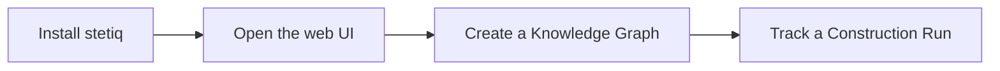

# Getting started

stetiq versions, evaluates and governs the Ontology of a Knowledge Graph, the way MLflow does for models. Your instance data stays in your graph database: stetiq only reads it to observe its structure.

This page takes you from installing stetiq to your first tracked Construction Run in the web UI. The words used here (Knowledge Graph, Ontology Version, Construction Run…) are explained on the [Concepts](./02-concepts.md) page.



## Install

stetiq needs Python 3.12 or later. Install it from PyPI:

```bash
pip install stetiq
```

This installs the Python SDK, the `stetiq` command and the web UI.

## Open the web UI

Start the web UI over a local tracking database:

```bash
stetiq ui
```

Then open <http://127.0.0.1:5000/ui>. `stetiq ui` runs in *local mode*: it needs no API Token and records every action under your OS user (or `$STETIQ_ACTOR`).

By default the tracking database is `.stetiq/stetiq.db` in the current folder. These settings change where stetiq reads and writes:

| Setting | Default | What it does |
| --- | --- | --- |
| `--tracking-uri` / `$STETIQ_TRACKING_URI` | `sqlite:///.stetiq/stetiq.db` | Where Knowledge Graphs, Ontology Versions and runs are stored. A `sqlite:///` or `postgresql://` URI is local mode; an `http(s)://` URI is a stetiq server. |
| `$STETIQ_ACTOR` | your OS user | Who local mode records as the actor in the audit log. |
| `$STETIQ_GRAPH_SOURCE_URI` | none | The Neo4j database the SDK observes when a Construction Run ends (with `$STETIQ_GRAPH_SOURCE_USER` and `$STETIQ_GRAPH_SOURCE_PASSWORD`). |
| `--port` | `5000` | The port `stetiq ui` listens on. |

## Create a Knowledge Graph

A Knowledge Graph starts from its Declared Ontology, written in stetiq YAML. Save this as `support.yaml`:

```yaml
node_types:
  - label: Customer
    properties:
      - name: name
        type: STRING
        required: true
  - label: Ticket
    description: A support request
relationship_types:
  - label: OPENED
patterns:
  - [Customer, OPENED, Ticket]
```

Create the Knowledge Graph and bind it to the part of your graph database it lives in (its Graph Source):

```bash
stetiq kg create support --ontology support.yaml
stetiq kg bind-source support --database neo4j
```

The Declared Ontology becomes Ontology Version 1.

## Track your first Construction Run

A Construction Run is one execution of your extraction workflow. Wrap the workflow in `start_run`: when the block ends, the SDK observes your Graph Source and stores its Observed Schema (structure and counts, never instance data), and stetiq measures its Conformance to the Declared Ontology.

```python
import stetiq

client = stetiq.Client()  # $STETIQ_TRACKING_URI, else .stetiq/stetiq.db

with client.start_run("support", ontology_version=1) as run:
    run.log_params({"llm": "claude", "chunk_size": 512})
    build_my_graph(run.declared_ontology)  # your extraction workflow
    run.log_metrics({"documents": 1200})
```

The SDK connects to Neo4j with `$STETIQ_GRAPH_SOURCE_URI`, or pass your own adapter as `stetiq.Client(graph_source=...)`. Your graph credentials stay in your process.

Reload the web UI: the *support* Knowledge Graph now lists the run under **Construction Runs**, with its params, metrics and Conformance.

## Next steps

- Read [Concepts](./02-concepts.md) to see how Ontology Versions, Aliases, Promotions and Gates fit together.
- Report problems on [GitHub](https://github.com/JoaZaech/stetiq/issues).
