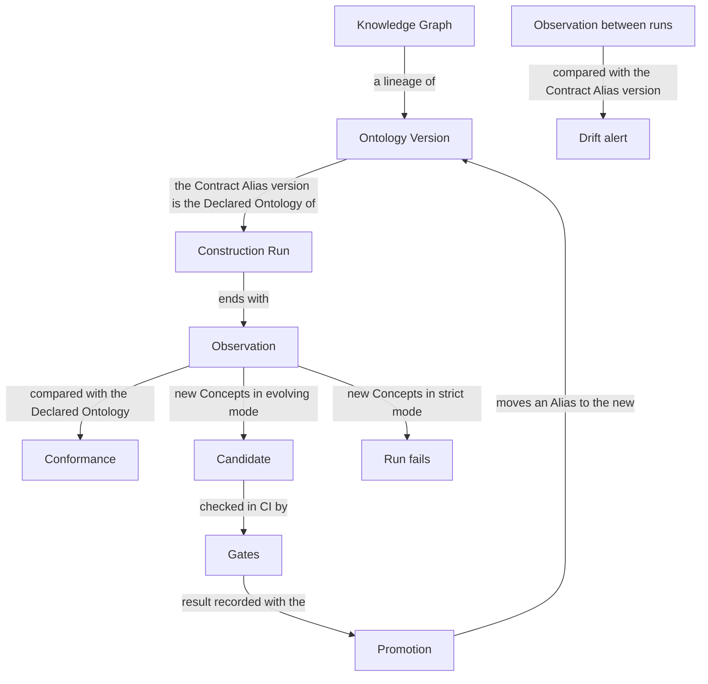

# Concepts

stetiq tracks the structure of a knowledge graph, not its data. This page walks through the words stetiq uses, in the order you meet them: a Knowledge Graph collects Ontology Versions, Construction Runs build the graph from one of them, Gates check what a run produced, a Promotion moves an Alias to a new version, and Observations watch the graph for Drift between runs.



## Knowledge Graphs and Ontology Versions

A **Knowledge Graph** is a named, long-lived lineage of Ontology Versions, e.g. `customer-support-kg`. It is not the graph database itself: the database, or the part of it this Knowledge Graph lives in, is its **Graph Source**, which stetiq reads but never owns.

The **Ontology** is the structure of the graph: its classes, relations, attributes, hierarchy and constraints, whatever formalism you write them in. Each class, relation or attribute is a **Concept**, identified across versions by its label (an attribute by its owner's label and its name). Renaming a Concept counts as removing one and adding another, unless you declare it as a replacement.

Every Concept can carry a **Definition**: what it is and what it excludes, written as `definition` in the stetiq YAML (`description`, its older spelling, is still accepted). It can also list **Alternative Labels** (`alternativeLabels`): other names people use for it, such as synonyms or acronyms ("WO" for WorkOrder). An Alternative Label never identifies a Concept, so it may not be another Concept's label in the same section (another class, relation, or attribute of the same owner).

```yaml
node_types:
  - label: WorkOrder
    definition: A request to perform maintenance on one Machine
    alternativeLabels: [WO]
    properties:
      - {name: status, type: STRING, definition: Where the work order is in its lifecycle}
```

A **Vocabulary** is a named, flat set of **Vocabulary Values** that an attribute may take, such as the statuses of a WorkOrder. It is part of the Ontology and versioned with it. A STRING attribute is bound to a Vocabulary with `vocabulary: <label>`, and one Vocabulary can be bound to several attributes (a shared `Status`, say). Each Vocabulary Value is identified by its label and, like a Concept, has its own Definition and Alternative Labels (for example the spellings a source system uses) and can be deprecated in favour of another value of the same Vocabulary. In the Ontology Diff a Vocabulary Value is named `<Vocabulary>.<value>`, e.g. `Status.done`. See [stetiq.yaml](./06-stetiq-yaml.md#vocabularies) for how to write them.

A Concept or Vocabulary Value can be **deprecated**: it stays in the Ontology but is on its way out, optionally naming its replacement and a **Deprecation reason** (`deprecationReason`) that tells Consumers why. The Ontology Version that introduces a Deprecation dates it. See [Deprecation](./06-stetiq-yaml.md#deprecation).

A pattern can declare its **cardinality**: the minimum and maximum number of relations each source node has to target nodes (`out`), or each target node has from source nodes (`in`), e.g. "a WorkOrder is PERFORMED_ON exactly one Machine". Conformance reports a pattern whose observed degree falls outside these bounds. See [Cardinality](./06-stetiq-yaml.md#cardinality).

An **Ontology Version** is an immutable snapshot of a Knowledge Graph's Ontology. Versions are numbered per Knowledge Graph (v1, v2…). Registering an Ontology that is identical to an existing version returns that version instead of creating a new one.

You create a Knowledge Graph from its Declared Ontology (see [Getting started](./01-getting-started.md#create-a-knowledge-graph)); it becomes v1, and the `production` Alias points to it.

The **Ontology Diff** between two Ontology Versions lists each change and classes it as *cosmetic* (only Definitions, Alternative Labels or Deprecation reasons changed, never what data conforms), *additive*, *deprecating* or *breaking*. It covers Vocabularies too: removing a Vocabulary Value or binding a Vocabulary to an existing attribute is *breaking*, for example. Its **Consumer impact** follows the breaking and deprecating changes through the Competency Questions that need their Concepts to the Tasks and Consumers of the Use Case (below): those are *affected* by a breaking change and *will be affected* by a deprecating one.

## Construction Runs and Conformance

A **Construction Run** is one execution of your extraction workflow against a Declared Ontology. stetiq records it as provenance: its params, metrics, status and what the graph looked like when it ended. stetiq doesn't run your workflow for you. You either wrap it in the SDK's `start_run` (see [Python SDK](./03-python-sdk.md)), or declare a **Construction Entry Point**, a command stetiq starts with `stetiq run` without knowing what it does inside (see [CLI](./04-cli.md) and [stetiq.yaml](./06-stetiq-yaml.md)).

The **Declared Ontology** is the structure a run is given as input. Unless you choose a version, it is the Ontology Version the Contract Alias points to (see [Aliases and Promotion](#aliases-and-promotion)).

When a run ends, stetiq makes an **Observation**: it captures the Graph Source's **Observed Schema**, the Ontology as it actually appears in the graph plus aggregate statistics (counts per class and relation, cardinalities, attribute fill rates, how many of each attribute's values have each type). It never contains instance data, with one exception: for an attribute bound to a Vocabulary it records the distinct values the attribute takes, each with a count, up to a cap (100 by default), since those values are what the Vocabulary permits. stetiq then measures the run's **Conformance**: how closely the Observed Schema matches the Declared Ontology (or, for an evolving run that adds Concepts, the Candidate it gave rise to; see [Evolution Mode and Candidates](#evolution-mode-and-candidates)). It lists every mismatch (a Concept declared but not observed or observed but not declared, a wrong value type, a cardinality outside its bounds, a value outside its attribute's Vocabulary) and scores the share of checks that hold. A required attribute that isn't always set, an attribute holding values of the wrong type and a value outside the Vocabulary also carry their **Violation Rate**: the share of nodes or relationships that fail the check. The rate doesn't change the score, which counts each check once.

## Evolution Mode and Candidates

A run can produce Concepts the Declared Ontology doesn't have, or values a Vocabulary doesn't have. The Knowledge Graph's **Evolution Mode** decides what happens then:

- *evolving* (the default): the run finishes, and stetiq registers a new Ontology Version that includes the new Concepts, and the new values as new Vocabulary Values, linked to the run.
- *strict*: the run fails.

**How a Candidate gets its Definitions.** stetiq builds the Candidate from what it observed, and the graph holds no Definitions, so the Concepts a run adds start without one. The run can propose a Definition for each Concept it adds (see [Python SDK](./03-python-sdk.md#construction-runs)). stetiq applies those proposals only to the Concepts the Candidate adds. It ignores, and lists on the run by Concept reference, any proposal for a Concept that was already declared or that the run didn't add, so a run can never rewrite a declared Definition, not even of a declared Class that shares its label with a Relation the run added.

**How an evolving run's Conformance is judged.** A run that gives rise to a Candidate is judged against that Candidate, not against its Declared Ontology. What it added (the new Concepts and Vocabulary Values) is the Candidate's Ontology Diff from the version the run consumed, not a Conformance mismatch, so a justified extension isn't punished. Everything the Candidate doesn't absorb still counts: a required attribute that isn't always set, a wrong value type, a cardinality outside its bounds, a new pattern between Concepts that were already declared. A strict run, and a run that gives rise to no Candidate, is judged against its Declared Ontology as before.

Whether an addition was *justified* is a separate question, answered by the Use Case: the `unjustified_additions` Evaluator counts the Concepts the Candidate adds that no Competency Question of the latest Use Case Version needs. An added Class or Relation is justified when a question needs it, through its explicit Concept mapping or its query (as structural answerability reads them); an added attribute when a question needs it, or when it belongs to an added Class or Relation that is justified. A question with neither a mapping nor a query justifies nothing, and added Vocabulary Values aren't judged. Declare the question before the run that needs the Concept, and gate on it (see [Evaluators and their metrics](./06-stetiq-yaml.md#evaluators-and-their-metrics)).

An Ontology Version no Alias has pointed to yet is a **Candidate**. A version registered by an evolving run is the typical Candidate, but a version you register yourself is one too until an Alias points to it.

## Evaluators and Use Cases

An **Evaluator** is a pluggable measurement of an Ontology that produces one or more metrics. stetiq runs its built-in Evaluators on every new Ontology Version, Candidates included, and on every Construction Run when it ends (its Conformance and Observed Schema). You can register your own Evaluators in the SDK.

A Knowledge Graph exists to solve a problem: its **Use Case**. A Use Case declares the **Consumers** that use the Knowledge Graph downstream (anyone or anything: an application, an agent, a dashboard, a team), the **Tasks** each Consumer performs with it, and the **Competency Questions** (domain questions the knowledge graph must be able to answer) each Task needs answered. One Competency Question may serve several Tasks, or none. A Consumer depends on Concepts only through its Tasks' Competency Questions. The Use Case is versioned on its own: adding, changing or removing a Consumer, Task or Competency Question yields a new **Use Case Version**, and each result stays tied to the Use Case Version it was judged against. A Consumer, Task or Competency Question keeps its id across Use Case Versions; changing the id counts as removing it and adding a new one.

stetiq also hands this back to your upstream pipeline. **The run context** is what the upstream pipeline should know before it extracts: the Ontology Version to extract against (by default the Contract Alias's), offered as a suggestion; the latest Use Case Version, so it knows which Tasks and Competency Questions the graph must serve; that version's evaluation results; and which questions passed, failed or errored on the latest finished run of that version; and what the last run that ended against that version added and how it was judged, even when its Candidate was never promoted. The upstream pipeline, whether an LLM agent or a static program, may then extend the Ontology where a question needs it. It carries metrics and counts, never instance data. Get it with `client.run_context` (see [Python SDK](./03-python-sdk.md#the-run-context)) or `stetiq context` (see [CLI](./04-cli.md#the-run-context)).

## Gates

A **Gate** is a rule, defined in your repository's `stetiq.yaml` (see [stetiq.yaml](./06-stetiq-yaml.md)), over Evaluator results, Conformance or the Ontology Diff, that must hold for a CI check to pass. For example: "no breaking changes compared with the Contract Alias's version" or "Conformance is at least 0.9".

`stetiq gate` evaluates the Gates for an Ontology Version or a Construction Run, records the result, and exits with a non-zero code when a Gate fails, so your CI check fails with it.

## Consumer Gates

A Gate judges a change's absolute health. A change can pass every Gate and still take something away from a Consumer: a Competency Question its dashboard runs returns 2 rows instead of 5. A **Consumer Gate** judges that: a rule, for one Consumer, over what a new Ontology Version or Construction Run gives that Consumer compared with the version it takes today. That divergence, between what a Consumer's Tasks rely on and what it would now get, is **Consumer Drift**. It is not Drift, which compares the Graph Source with the Contract Alias's version.

Each Consumer declares its own Consumer Gates in the Use Case (`consumer_gates`, see [Consumer Gates](./03-python-sdk.md#consumer-gates)), so the Consumer's team owns what "safe" means for it, and the gates are versioned with the Use Case Version. The one kind built, `row_count_drop`, compares each Competency Question of one Task: its executed row count on the Construction Run being judged against the latest finished run on the Contract Alias's version (the baseline). It fails when a question's row count drops by more than the declared limit, and when it cannot compare (no baseline run, or no row count on either side), so a missing input is never a pass. A question declared since the baseline run has no baseline to lose against: it is reported as new and not compared.

`stetiq consumer gate` evaluates every Consumer's Consumer Gates, records the verdicts, and exits 3 when one fails, so your pipeline's CI can run it beside `stetiq gate`. A verdict names the symptom (the Consumer, Task, Competency Question and the row change), never a guessed cause. Consumer Gate verdicts never reach the Promotion audit. Checking them before a Consumer takes a version (a Connector) and on every scheduled Observation is planned.

## Aliases and Promotion

An **Alias** is a named, movable pointer to one Ontology Version within a Knowledge Graph, e.g. `production` or `staging`.

One Alias is the **Contract Alias**, by default `production`. Its Ontology Version is the one Construction Runs consume as their Declared Ontology and the one Drift is measured against.

A **Promotion** moves an Alias to an Ontology Version, typically to a Candidate that passed its Gates. Gates don't block a Promotion, but the audit log records whether the version's latest Gate result passed, along with who promoted it and when. Moving an Alias back to an earlier version is a Promotion too, so a rollback is logged the same way. You can promote from the SDK, the CLI or the web UI (see [Using the web UI](./07-using-the-web-ui.md)).

## Observation and Drift

The graph can change between runs: someone edits it by hand, or another process writes to it. You can make an Observation on demand, outside any Construction Run, with `stetiq observe` or the SDK. Schedule it with cron, Airflow or CI.

**Drift** is a divergence, found by an Observation, between the Graph Source's Observed Schema and the Contract Alias's Ontology Version: a Concept observed but not declared, one declared but no longer observed, or a value outside its attribute's Vocabulary (with how many nodes hold it and their share). Drift raises an alert. It never creates an Ontology Version or moves an Alias: deciding what the structure should be stays a Promotion.

Every Observation also carries a Conformance score: an on-demand one is judged against the Contract Alias's Ontology Version at that moment, and one that ends a Construction Run has its run's. The [Observations page](./07-using-the-web-ui.md#observations) shows these scores over time as the **Alignment trend**, so you can see whether the graph is getting more or less aligned with its Ontology. The trend has no threshold and raises no Drift.

stetiq also watches statistics:

- **Counts** are compared with the previous Observation, and a change beyond your thresholds is Drift.
- **Violation Rates** are compared with the **Baseline Observation**. A Violation Rate is the share of nodes or relationships that fail a Conformance check, e.g. the share of Customers without their required `name`, or of WorkOrders PERFORMED_ON more Machines than the pattern's cardinality allows. The Baseline Observation is the first Observation (the end of a Construction Run counts) since the Contract Alias's current Ontology Version became the contract, by a Promotion or by switching the Contract Alias. A rate more than one percentage point above its baseline value is Drift (`violation_increase`, see [`drift`](./06-stetiq-yaml.md#drift)). So a slow decay shows up even when no two Observations differ much, and a graph that has always had a few gaps doesn't alert on every Observation. The first Observation after a Promotion is its own baseline, so it raises no rate Drift.
- **Coverage** is compared with the Baseline Observation too, if you set [`max_coverage_drop`](./06-stetiq-yaml.md#drift). A declared pattern's Coverage is the share of its source nodes that have at least one such relation (out-degree), or of its target nodes (in-degree), e.g. the share of WorkOrders on a Machine. A fall of more than your threshold, in percentage points, is Drift (`coverage_drop`).

A check that lacks its input raises no Drift. It is listed with the Observation as **not comparable** instead, e.g. when the Baseline Observation didn't observe the Attribute at all, or when an Attribute had more distinct values than stetiq reads, so their share is unknown.

## Where your data stays

Your extraction workflow, your custom Evaluators and your graph credentials stay in your own process. Only aggregates (Observed Schemas, metrics, Evaluator results) reach stetiq, whether it runs locally or as a server. Sharing one tracking database between people is what a stetiq server and its **API Tokens** are for (see [Server & API Tokens](./05-server-and-api-tokens.md)).

## Next steps

- [Getting started](./01-getting-started.md): install stetiq and track your first Construction Run.
- [Python SDK](./03-python-sdk.md) and [CLI](./04-cli.md): every operation on this page.
- [Server & API Tokens](./05-server-and-api-tokens.md): share a tracking database.
- [stetiq.yaml](./06-stetiq-yaml.md): Gates, Drift thresholds and the Construction Entry Point.
- [Using the web UI](./07-using-the-web-ui.md): browse and promote Ontology Versions.
