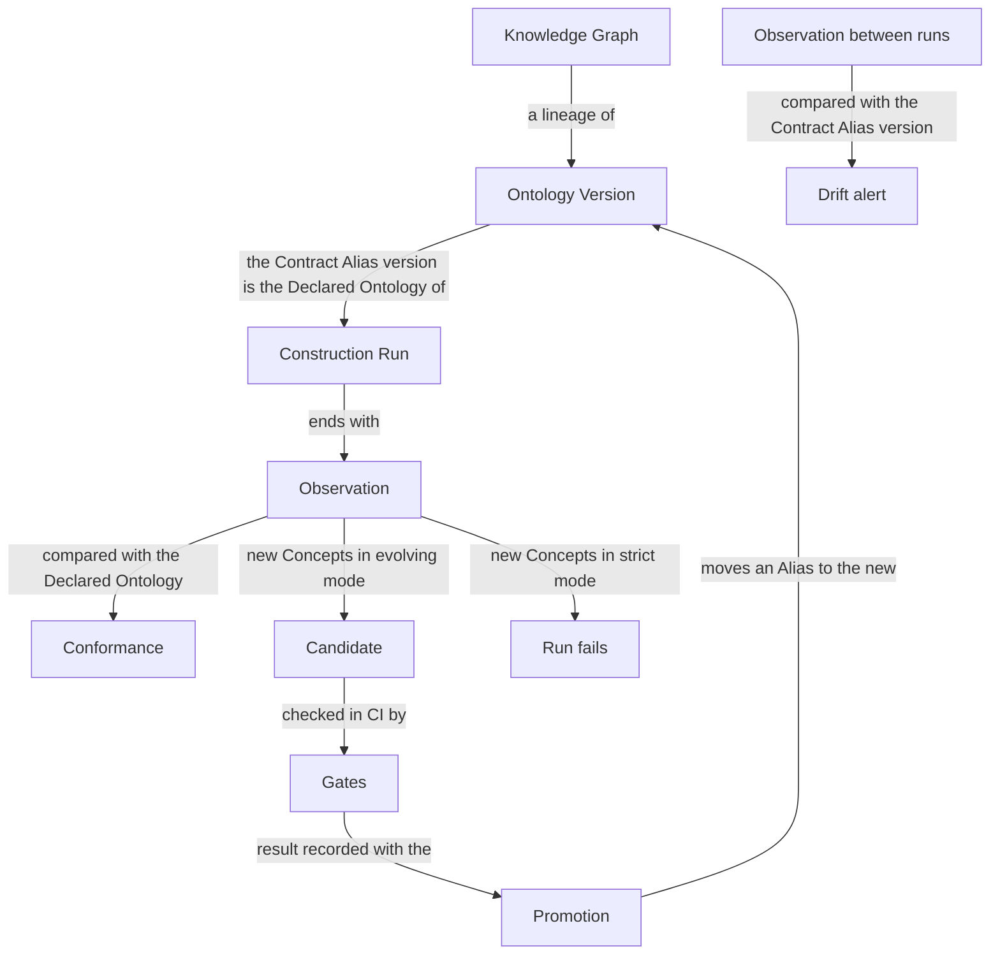

# Concepts

stetiq tracks the structure of a knowledge graph, not its data. This page walks through the words stetiq uses, in the order you meet them: a Knowledge Graph collects Ontology Versions, Construction Runs build the graph from one of them, Gates check what a run produced, a Promotion moves an Alias to a new version, and Observations watch the graph for Drift between runs.

## Knowledge Graphs and Ontology Versions

A **Knowledge Graph** is a named, long-lived lineage of Ontology Versions, e.g. `customer-support-kg`. It is not the graph database itself: the database, or the part of it this Knowledge Graph lives in, is its **Graph Source**, which stetiq reads but never owns.

The **Ontology** is the structure of the graph: its classes, relations, attributes, hierarchy and constraints, whatever formalism you write them in. Each class, relation or attribute is a **Concept**, identified by its name or IRI across versions. Renaming a Concept counts as removing one and adding another, unless you declare it as a replacement.

An **Ontology Version** is an immutable snapshot of a Knowledge Graph's Ontology. Versions are numbered per Knowledge Graph (v1, v2…). Registering an Ontology that is identical to an existing version returns that version instead of creating a new one.

You create a Knowledge Graph from its Declared Ontology (see [Getting started](./01-getting-started.md#create-a-knowledge-graph)); it becomes v1, and the `production` Alias points to it.

The **Ontology Diff** between two Ontology Versions lists each change and classes it as *cosmetic* (only a description changed), *additive*, *deprecating* or *breaking*.

## Construction Runs and Conformance

A **Construction Run** is one execution of your extraction workflow against a Declared Ontology. stetiq records it as provenance: its params, metrics, status and what the graph looked like when it ended. stetiq doesn't run your workflow for you. You either wrap it in the SDK's `start_run` (see [Python SDK](./03-python-sdk.md)), or declare a **Construction Entry Point**, a command stetiq starts with `stetiq run` without knowing what it does inside (see [CLI](./04-cli.md) and [stetiq.yaml](./06-stetiq-yaml.md)).

The **Declared Ontology** is the structure a run is given as input. Unless you choose a version, it is the Ontology Version the Contract Alias points to (see [Aliases and Promotion](#aliases-and-promotion)).

When a run ends, stetiq makes an **Observation**: it captures the Graph Source's **Observed Schema**, the Ontology as it actually appears in the graph plus aggregate statistics (counts per class and relation, cardinalities, attribute fill rates). It never contains instance data. stetiq then measures the run's **Conformance**: how closely the Observed Schema matches the Declared Ontology.

## Evolution Mode and Candidates

A run can produce Concepts the Declared Ontology doesn't have. The Knowledge Graph's **Evolution Mode** decides what happens then:

- *evolving* (the default): the run finishes, and stetiq registers a new Ontology Version that includes the new Concepts, linked to the run.
- *strict*: the run fails.

An Ontology Version no Alias has pointed to yet is a **Candidate**. A version registered by an evolving run is the typical Candidate, but a version you register yourself is one too until an Alias points to it.

## Evaluators and Use Cases

An **Evaluator** is a pluggable measurement of an Ontology that produces one or more metrics. stetiq runs its built-in Evaluators on every new Ontology Version, Candidates included, and on every Construction Run when it ends (its Conformance and Observed Schema). You can register your own Evaluators in the SDK.

A Knowledge Graph exists to solve a problem: its **Use Case**, expressed as a set of **Competency Questions** (domain questions the knowledge graph must be able to answer) and tasks. The Use Case is versioned on its own: adding, changing or removing a Competency Question yields a new **Use Case Version**, and each result stays tied to the Use Case Version it was judged against. A Competency Question keeps its id across Use Case Versions; changing the id counts as removing it and adding a new one.

## Gates

A **Gate** is a rule, defined in your repository's `stetiq.yaml` (see [stetiq.yaml](./06-stetiq-yaml.md)), over Evaluator results, Conformance or the Ontology Diff, that must hold for a CI check to pass. For example: "no breaking changes compared with the Contract Alias's version" or "Conformance is at least 0.9".

`stetiq gate` evaluates the Gates for an Ontology Version or a Construction Run, records the result, and exits with a non-zero code when a Gate fails, so your CI check fails with it.

## Aliases and Promotion

An **Alias** is a named, movable pointer to one Ontology Version within a Knowledge Graph, e.g. `production` or `staging`.

One Alias is the **Contract Alias**, by default `production`. Its Ontology Version is the one Construction Runs consume as their Declared Ontology and the one Drift is measured against.

A **Promotion** moves an Alias to an Ontology Version, typically to a Candidate that passed its Gates. Gates don't block a Promotion, but the audit log records whether the version's latest Gate result passed, along with who promoted it and when. Moving an Alias back to an earlier version is a Promotion too, so a rollback is logged the same way. You can promote from the SDK, the CLI or the web UI (see [Using the web UI](./07-using-the-web-ui.md)).

## Observation and Drift

The graph can change between runs: someone edits it by hand, or another process writes to it. You can make an Observation on demand, outside any Construction Run, with `stetiq observe` or the SDK. Schedule it with cron, Airflow or CI.

**Drift** is a divergence, found by an Observation, between the Graph Source's Observed Schema and the Contract Alias's Ontology Version. stetiq also compares the Observation's statistics with the previous Observation and reports changes beyond your thresholds. Drift raises an alert. It never creates an Ontology Version or moves an Alias: deciding what the structure should be stays a Promotion.

## Where your data stays

Your extraction workflow, your custom Evaluators and your graph credentials stay in your own process. Only aggregates (Observed Schemas, metrics, Evaluator results) reach stetiq, whether it runs locally or as a server. Sharing one tracking database between people is what a stetiq server and its **API Tokens** are for (see [Server & API Tokens](./05-server-and-api-tokens.md)).

## Next steps

- [Getting started](./01-getting-started.md): install stetiq and track your first Construction Run.
- [Python SDK](./03-python-sdk.md) and [CLI](./04-cli.md): every operation on this page.
- [Server & API Tokens](./05-server-and-api-tokens.md): share a tracking database.
- [stetiq.yaml](./06-stetiq-yaml.md): Gates, Drift thresholds and the Construction Entry Point.
- [Using the web UI](./07-using-the-web-ui.md): browse and promote Ontology Versions.
