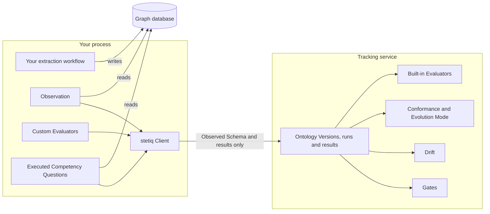

# Python SDK

The Python SDK is how your extraction workflow talks to stetiq: it registers Ontology Versions, records Construction Runs, observes your Graph Source and runs your own Evaluators. Everything goes through one object, `stetiq.Client`. The words used here are explained on the [Concepts](./02-concepts.md) page.

## Create a Client

```python
import stetiq

client = stetiq.Client()
```

The Client needs a tracking URI, which says where Knowledge Graphs, Ontology Versions and Construction Runs are stored. It takes the first of these that is set:

1. the first argument, `stetiq.Client("sqlite:///kg/stetiq.db")`;
2. `$STETIQ_TRACKING_URI`;
3. `sqlite:///.stetiq/stetiq.db`, a database in the current folder.

The tracking URI also picks the mode:

| Tracking URI | Mode | What the Client does |
| --- | --- | --- |
| `sqlite:///<path>` or `postgresql://…` | local | Works directly on that database, in your process. No API Token. |
| `http://…` or `https://…` | remote | Sends every request to a stetiq server, with the API Token from `token=` or `$STETIQ_TOKEN`. |

```python
client = stetiq.Client("https://stetiq.example.com", token=my_token)
```

The CLI resolves the tracking URI the same way (see [CLI](./04-cli.md#tracking-uri)). Running a server and issuing API Tokens is covered in [Server & API Tokens](./05-server-and-api-tokens.md).

Other arguments:

- `graph_source=`: the adapter that observes your Graph Source (see [Graph Source](#graph-source)).
- `actor=`: who the audit log records when this Client moves an Alias in local mode. Default `$STETIQ_ACTOR`, else your OS user. In remote mode the server records the API Token's user and ignores it.

## What runs where

Your graph database credentials and your own code never leave your process. The SDK reads the Graph Source itself and sends only aggregates to the tracking service: the Observed Schema (labels, counts, fill rates, cardinalities) and Evaluator results, never an individual node or relationship. In remote mode the server never connects to your graph database.



In local mode the tracking service runs inside your process too, but the split is the same. In remote mode it is the stetiq server, which decides every verdict: Conformance, the Evolution Mode outcome, Drift, Gate outcomes and who did what in the audit log.

## Knowledge Graphs and Ontology Versions

Create a Knowledge Graph from its Declared Ontology. The ontology can be a path to a stetiq YAML file, YAML text, or an `Ontology` object. It becomes Ontology Version 1, and the `production` Alias points to it.

```python
from pathlib import Path

kg = client.create_knowledge_graph("support", ontology=Path("support.yaml"))
```

Name the Knowledge Graph's Steward (who watches its Drift and keeps its Definitions and Competency Questions current) and its Authority (who decides changes to its Ontology). Both are free strings for display and routing, for example to send Drift to the right person; they grant no permission, and setting them needs `edit`. A name you leave out stays as it is, and an empty string clears it.

```python
client.set_knowledge_graph_governance("support", steward="Ada", authority="Support ops board")
kg = client.get_knowledge_graph("support")
print(kg.steward, kg.authority)
client.set_knowledge_graph_governance("support", steward="")  # clears the Steward only
```

Register a changed Ontology by hand. Registering content identical to an existing version returns that version instead of creating a new one.

```python
v2 = client.register_ontology("support", Path("support-v2.yaml"))
print(v2.number, v2.content_hash)
```

Read them back:

```python
client.list_ontology_versions("support")      # oldest first
client.get_ontology_yaml("support", 2)          # stetiq YAML text
client.get_ontology_version_by_alias("support", "production")
```

Compare two versions with an Ontology Diff. Each change is classified as cosmetic (only a description changed), additive, deprecating or breaking. `detail` says what changed in words; to act on a change in code, read its fields instead: `owner`, `owner_kind` and `attribute` for a change to an attribute, `required` for an added attribute, and `pattern` for an added or removed endpoint Pattern (each `None` when it doesn't apply). Without version numbers, it compares the Contract Alias's version with the latest Candidate. `diff_ontologies` compares two Ontologies that need not be registered, such as two files in your repository.

```python
diff = client.diff_ontology_versions("support", 1, 2)
print(diff.classification)
for change in diff.changes:
    print(change.classification, change.kind, change.concept, change.detail)

client.diff_ontologies(Path("main/support.yaml"), Path("support.yaml"))
```

The stetiq YAML format itself is described in [Getting started](./01-getting-started.md#create-a-knowledge-graph).

## Graph Source

A Knowledge Graph is bound to a Graph Source: a database in your graph store, optionally narrowed to nodes with one label or one namespace. stetiq only reads it.

```python
client.bind_graph_source("support", stetiq.GraphSourceScope(database="neo4j", label="Support"))
```

To observe the Graph Source, the Client needs an adapter with your credentials. By default it builds a Neo4j adapter the first time it needs one, from these environment variables:

| Variable | What it holds |
| --- | --- |
| `$STETIQ_GRAPH_SOURCE_URI` | The Neo4j URI, e.g. `neo4j://localhost:7687` (`bolt://`, `neo4j+s://` and so on also work). |
| `$STETIQ_GRAPH_SOURCE_USER` | The Neo4j user. |
| `$STETIQ_GRAPH_SOURCE_PASSWORD` | The Neo4j password. |

Or pass an adapter yourself:

```python
from stetiq.graph_source import Neo4jGraphSource

client = stetiq.Client(
    graph_source=Neo4jGraphSource.connect("neo4j://localhost:7687", user="neo4j", password=pw)
)
```

The credentials stay in this process: they are never sent to the tracking service or stored, only the scope is. For tests, `stetiq.InMemoryGraphSource()` is an in-memory graph you fill with `add_node` and `add_relationship`.

Starting a Construction Run or taking an Observation without an adapter fails with `GraphSourceUnavailableError`.

## Construction Runs

A Construction Run is one execution of your extraction workflow. Start one with `start_run` and use it as a context manager:

```python
with client.start_run("support") as run:
    run.log_params({"llm": "claude", "chunk_size": 512})
    build_my_graph(run.declared_ontology)  # your extraction workflow
    run.log_metrics({"documents": 1200, "cost_usd": 3.20})
```

- **Declared Ontology.** By default the run consumes the Ontology Version the Contract Alias points to. Pass `ontology_version=3` or `alias="staging"` to choose another; passing both raises `ConflictingArgumentsError`. `run.declared_ontology` is that Ontology, and `run.ontology_version` its number.
- **Params and metrics.** `log_param`/`log_params` store strings; `log_metric`/`log_metrics` store numbers. Logging a key again replaces its value.
- **Ending the run.** When the block ends, the SDK observes the whole bound Graph Source scope and stores the Observed Schema. The tracking service then measures Conformance to the Declared Ontology and applies the Knowledge Graph's Evolution Mode. If the Observation itself fails, the run is marked failed.
- **Failing the run.** An exception inside the block marks the run failed, observes nothing, and is raised again. Call `run.fail()` to fail it yourself, or `run.end()` to end it early.

What happens when the run observed Concepts its Declared Ontology does not have depends on the Evolution Mode:

```python
client.set_evolution_mode("support", "evolving")  # or "strict"
```

- *evolving* (the default): the run finishes and a Candidate Ontology Version is registered from what it observed, linked to the run.
- *strict*: the run is marked failed.

Then read the result:

```python
finished = client.get_run(run.id)
print(finished.status, finished.conformance.score, finished.candidate_version)

client.list_runs("support")                      # oldest first
client.compare_runs([first_id, second_id])       # params, metrics, Conformance side by side
```

If your workflow is a command rather than Python code, declare it as the Construction Entry Point in [`stetiq.yaml`](./06-stetiq-yaml.md) and start it with `stetiq run` (see [CLI](./04-cli.md)). `client.run_entry_point(...)` does the same from Python.

## Observations and Drift

Take an Observation between runs, for example from a nightly job, to find Drift: a divergence between the Graph Source and the Contract Alias's Ontology Version.

```python
outcome = client.observe(
    "support", thresholds=stetiq.DriftThresholds(max_count_drop=0.2, max_count_increase=1.0)
)
if outcome.drift is not None:
    for finding in outcome.drift.findings:
        print(finding.kind, finding.subject, finding.detail)
```

The Observation is compared with the Contract Alias's Ontology Version (structural Drift) and with the previous Observation (statistical Drift, only for count changes beyond the thresholds, as fractions: `0.2` is 20 %). Drift raises a Drift event; it never creates an Ontology Version. `client.list_observations("support")` and `client.list_drift_events("support")` list them, oldest first. `stetiq observe` does the same from the command line.

## Use Cases and Competency Questions

A Use Case is the set of Competency Questions the Knowledge Graph must answer. Register it from a YAML file (or text, or a list of `CompetencyQuestion`s); each registration with new content is a new Use Case Version.

```yaml
competency_questions:
  - id: tickets-per-customer
    question: How many tickets has each customer opened?
    query: MATCH (c:Customer)-[:OPENED]->(t:Ticket) RETURN c.name, count(t)
  - id: customer-names
    question: What are our customers called?
    concepts: [Customer.name]
```

```python
client.register_use_case("support", Path("use-case.yaml"))
client.add_competency_question(
    "support", {"id": "open-tickets", "question": "Which tickets are open?", "concepts": ["Ticket"]}
)
```

`add_competency_question` adds one question to the latest Use Case Version and registers the result as a new one. `client.get_use_case_version("support")` without a number returns the latest Use Case Version, and raises `NoUseCaseError` (a `NotFoundError`) when there is none. Every new Ontology Version is judged against the latest Use Case (`structural_answerability`: does the Ontology have the Concepts each question needs?). At the end of a Construction Run, the SDK also executes the questions that have a `query` against your Graph Source (`competency_question_execution`). Their rows are judged and then dropped: only the result leaves your process.

## Evaluators

An Evaluator measures an Ontology Version or a Construction Run and produces metrics. The built-in ones run in the tracking service whenever a new version is registered or a run ends. Read their results with:

```python
client.get_evaluation_results("support", 2)      # an Ontology Version
client.get_run_evaluation_results(run.id)        # a Construction Run
```

### Custom Evaluators

Write your own by subclassing `stetiq.OntologyVersionEvaluator` (sees only the Ontology Version) or `stetiq.ConstructionRunEvaluator` (sees the run, its Declared Ontology, its Observation and read-only access to the Graph Source). Give it a unique `name` and return an `Evaluation` of named numeric metrics, with optional per-item `Detail`s:

```python
from stetiq import Detail, Evaluation, OntologyVersionEvaluator


class Documented(OntologyVersionEvaluator):
    name = "documented"

    def evaluate(self, version):
        node_types = version.ontology.node_types
        missing = [n.label for n in node_types if not n.description]
        return Evaluation(
            metrics={"undocumented": len(missing)},
            details=[Detail(item=label, message="no description") for label in missing],
        )


client.register_evaluator(Documented())
```

A registered Evaluator runs in your process, and only its results are sent to the tracking service:

- an `OntologyVersionEvaluator` on every Ontology Version this Client creates, and on `client.evaluate(...)`;
- a `ConstructionRunEvaluator` at the end of every Construction Run this Client starts, and on `client.evaluate_run(...)`.

Registration lasts as long as the Client and is not stored. To run an Evaluator once, without registering it, pass it as `evaluators=`. That is how the gold-standard comparison works:

```python
gold = client.get_ontology_version("support", 1)
client.evaluate("support", 3, evaluators=[stetiq.GoldOntologyAlignment(gold)])
client.evaluate_run(run.id, evaluators=[MyRunCheck()])
```

If an Evaluator raises, the SDK raises `EvaluatorError`; the version or run it was evaluating is already recorded. The names of the built-in Evaluators (`hierarchy`, `isolated_node_types`, `orphan_concepts`, `redundancy`, `constraint_consistency`, `structural_answerability`, `conformance`, `observed_schema`, `competency_question_execution`) are reserved.

## Aliases, Promotion and Gates

```python
client.evaluate_gates("support", "stetiq.yaml", version=3)  # Gates from your repo config
client.set_alias("support", "production", 3)                # Promotion (or rollback)
client.list_promotions("support")                           # the audit log
```

`evaluate_gates` sends the Gate definitions to the tracking service, which computes and records the outcome. It gates the latest Ontology Version by default, `version=N`, or a Construction Run with `run=ID`; passing both `version` and `run` raises `ConflictingArgumentsError`. Gates never block a Promotion, but the audit log records whether the version's latest Gate result passed. Gates are written in [`stetiq.yaml`](./06-stetiq-yaml.md).

## Errors

Every error the SDK raises is a `stetiq.StetiqError`, with a subclass per cause, for example `NotFoundError`, `OntologyValidationError`, `PermissionDeniedError` (remote mode, the API Token lacks a permission) and `AuthenticationError` (remote mode, no or an invalid API Token).
