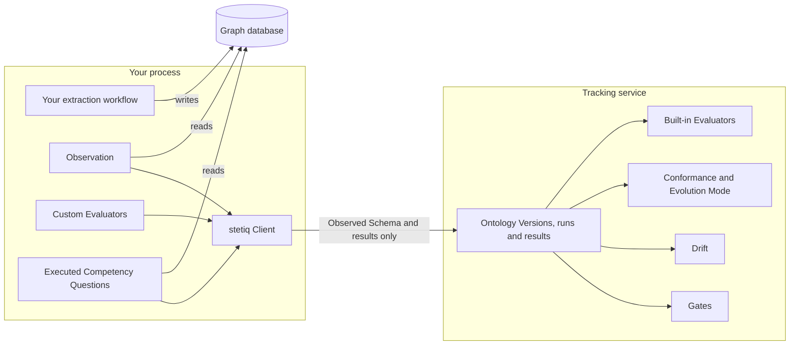

# Python SDK

The Python SDK is how your extraction workflow talks to stetiq: it registers Ontology Versions, records Construction Runs, observes your Graph Source and runs your own Evaluators. Everything goes through one object, `stetiq.Client`. The words used here are explained on the [Concepts](./02-concepts.md) page.

## Create a Client

```python
import stetiq

client = stetiq.Client()
```

The Client needs a tracking URI, which says where Knowledge Graphs, Ontology Versions and Construction Runs are stored. It takes the first of these that is set:

1. the first argument, `stetiq.Client("sqlite:///kg/stetiq.db")`;
2. `$STETIQ_TRACKING_URI`;
3. `sqlite:///.stetiq/stetiq.db`, a database in the current folder.

The tracking URI also picks the mode:

| Tracking URI | Mode | What the Client does |
| --- | --- | --- |
| `sqlite:///<path>` or `postgresql://…` | local | Works directly on that database, in your process. No API Token. |
| `http://…` or `https://…` | remote | Sends every request to a stetiq server, with the API Token from `token=` or `$STETIQ_TOKEN`. |

```python
client = stetiq.Client("https://stetiq.example.com", token=my_token)
```

The CLI resolves the tracking URI the same way (see [CLI](./04-cli.md#tracking-uri)). Running a server and issuing API Tokens is covered in [Server & API Tokens](./05-server-and-api-tokens.md).

Other arguments:

- `graph_source=`: the adapter that observes your Graph Source (see [Graph Source](#graph-source)).
- `value_cap=`: how many distinct values an Observation reads per Vocabulary-bound attribute (default 100; see [Vocabulary values](#vocabulary-values)).
- `actor=`: who the audit log records when this Client moves an Alias in local mode. Default `$STETIQ_ACTOR`, else your OS user. In remote mode the server records the API Token's user and ignores it.

## What runs where

Your graph database credentials and your own code never leave your process. The SDK reads the Graph Source itself and sends only aggregates to the tracking service: the Observed Schema (labels, counts, fill rates, cardinalities, and the capped values of Vocabulary-bound attributes) and Evaluator results, never an individual node or relationship. In remote mode the server never connects to your graph database.



In local mode the tracking service runs inside your process too, but the split is the same. In remote mode it is the stetiq server, which decides every verdict: Conformance, the Evolution Mode outcome, Drift, Gate outcomes and who did what in the audit log.

## Knowledge Graphs and Ontology Versions

Create a Knowledge Graph from its Declared Ontology. The ontology can be a path to a stetiq YAML file, YAML text, or an `Ontology` object. It becomes Ontology Version 1, and the `production` Alias points to it.

```python
from pathlib import Path

kg = client.create_knowledge_graph("support", ontology=Path("support.yaml"))
```

Register a changed Ontology by hand. Registering content identical to an existing version returns that version instead of creating a new one.

```python
v2 = client.register_ontology("support", Path("support-v2.yaml"))
print(v2.number, v2.content_hash)
```

Read them back:

```python
client.list_ontology_versions("support")      # oldest first
client.get_ontology_yaml("support", 2)          # stetiq YAML text
client.get_ontology_version_by_alias("support", "production")
```

Compare two versions with an Ontology Diff. Each change is classified as cosmetic (only a Definition, Alternative Labels or a Deprecation reason changed), additive, deprecating or breaking. `detail` says what changed in words; to act on a change in code, read its fields instead: `owner`, `owner_kind` and `attribute` for a change to an attribute, `required` for an added attribute, `pattern` for an endpoint Pattern added, removed or given a different cardinality, `vocabulary` and `value` for a change to a Vocabulary or one of its Vocabulary Values, and `bound_vocabulary` for a change that binds an attribute to a Vocabulary, naming the Vocabulary it is now bound to (each `None` when it doesn't apply). Without version numbers, it compares the Contract Alias's version with the latest Candidate. `diff_ontologies` compares two Ontologies that need not be registered, such as two files in your repository.

```python
diff = client.diff_ontology_versions("support", 1, 2)
print(diff.classification)
for change in diff.changes:
    print(change.classification, change.kind, change.concept, change.detail)

client.diff_ontologies(Path("main/support.yaml"), Path("support.yaml"))
```

### Consumer impact

`consumer_impact` answers "which Consumers does this change hit?". It follows each change of the Ontology Diff through Concept → Competency Question → Task → Consumer, against the latest Use Case Version (or `use_case_version=`):

- a **breaking** change makes every question that needs its Concept, and the Tasks and Consumers that need that question, **affected**;
- a **deprecating** change makes them **will be affected**: they still work, but not for long;
- cosmetic and additive changes hit nothing.

A question's Concepts are read the way structural answerability reads them: its `concepts` mapping, otherwise its `query`. An attribute change also hits a question about a class that inherits the attribute, and an endpoint Pattern change hits only the paths that Pattern serves. A question with neither `concepts` nor a `query`, which only an LLM question mapper could map, is **unknown** whenever the Diff breaks or deprecates anything, so it is never reported as unaffected. The versions default as for `diff_ontology_versions`. Without a Use Case it raises `NoUseCaseError`.

```python
impact = client.consumer_impact("support", 1, 2)
for consumer in impact.consumers:  # only the Consumers hit
    print(consumer.level, consumer.name)  # affected, will_be_affected or unknown
    for task in consumer.tasks:
        for question in task.questions:
            print("  ", task.id, question.id, [c.concept for c in question.changes])
for question in impact.no_consumer:  # hit questions no Task needs
    print("no Consumer:", question.id, question.level)
impact.by_level("affected")  # the affected Consumers only
```

A Task or Consumer takes the most severe level among its questions, and lists only the Tasks and questions that are hit, each question with the changes that hit it.

The stetiq YAML format itself is described in [Getting started](./01-getting-started.md#create-a-knowledge-graph).

## Graph Source

A Knowledge Graph is bound to a Graph Source: a database in your graph store, optionally narrowed to nodes with one label or one namespace. stetiq only reads it.

```python
client.bind_graph_source("support", stetiq.GraphSourceScope(database="neo4j", label="Support"))
```

To observe the Graph Source, the Client needs an adapter with your credentials. By default it builds a Neo4j adapter the first time it needs one, from these environment variables:

| Variable | What it holds |
| --- | --- |
| `$STETIQ_GRAPH_SOURCE_URI` | The Neo4j URI, e.g. `neo4j://localhost:7687` (`bolt://`, `neo4j+s://` and so on also work). |
| `$STETIQ_GRAPH_SOURCE_USER` | The Neo4j user. |
| `$STETIQ_GRAPH_SOURCE_PASSWORD` | The Neo4j password. |

Or pass an adapter yourself:

```python
from stetiq.graph_source import Neo4jGraphSource

client = stetiq.Client(
    graph_source=Neo4jGraphSource.connect("neo4j://localhost:7687", user="neo4j", password=pw)
)
```

The credentials stay in this process: they are never sent to the tracking service or stored, only the scope is. For tests, `stetiq.InMemoryGraphSource()` is an in-memory graph you fill with `add_node` and `add_relationship`.

Starting a Construction Run or taking an Observation without an adapter fails with `GraphSourceUnavailableError`.

### Vocabulary values

An Observation reads instance values for one kind of attribute only: one bound to a Vocabulary (see [Vocabularies](./06-stetiq-yaml.md#vocabularies)). When a run ends, the bound attributes are those of its Declared Ontology; for `client.observe` and `stetiq observe`, those of the Contract Alias's version. The SDK works them out in your process and asks the adapter for exactly those attributes, so no other attribute's values are read.

For each bound attribute the Observed Schema records the distinct string values it takes, most frequent first, each with the number of nodes or relationships holding it. At most `value_cap` distinct values are kept per attribute (100 unless you pass `stetiq.Client(value_cap=...)`), so a free-text attribute bound by mistake can't send its contents to stetiq. When the attribute has more distinct values than the cap, only the most frequent are kept and `truncated` is set:

```python
work_order = outcome.observation.schema.node_type("WorkOrder")
status = next(p for p in work_order.properties if p.name == "status")
status.values.counts     # (ValueCount(value="open", count=2), ValueCount(value="closed", count=1))
status.values.truncated  # False: these are all the values
```

`values` is `None` for every attribute that isn't bound to a Vocabulary. An adapter you write yourself receives the bound attributes as `(owner kind, owner label, attribute)` triples, plus `value_cap`; for an Ontology without Vocabularies it is called with the scope alone, as before.

## Construction Runs

A Construction Run is one execution of your extraction workflow. Start one with `start_run` and use it as a context manager:

```python
with client.start_run("support") as run:
    run.log_params({"llm": "claude", "chunk_size": 512})
    build_my_graph(run.declared_ontology)  # your extraction workflow
    run.log_metrics({"documents": 1200, "cost_usd": 3.20})
```

- **Declared Ontology.** By default the run consumes the Ontology Version the Contract Alias points to. Pass `ontology_version=3` or `alias="staging"` to choose another; passing both raises `ConflictingArgumentsError`. `run.declared_ontology` is that Ontology, and `run.ontology_version` its number.
- **Params and metrics.** `log_param`/`log_params` store strings; `log_metric`/`log_metrics` store numbers. Logging a key again replaces its value.
- **Ending the run.** When the block ends, the SDK observes the whole bound Graph Source scope and stores the Observed Schema. The tracking service then applies the Knowledge Graph's Evolution Mode and measures Conformance: against the Candidate when an evolving run gave rise to one, otherwise against the Declared Ontology (see [Evolution Mode and Candidates](./02-concepts.md#evolution-mode-and-candidates)). If the Observation itself fails, the run is marked failed.
- **Failing the run.** An exception inside the block marks the run failed, observes nothing, and is raised again. Call `run.fail()` to fail it yourself, or `run.end()` to end it early.

What happens when the run observed Concepts its Declared Ontology does not have depends on the Evolution Mode:

```python
client.set_evolution_mode("support", "evolving")  # or "strict"
```

- *evolving* (the default): the run finishes and a Candidate Ontology Version is registered from what it observed, linked to the run. The run's Conformance is judged against that Candidate, so what it added is not a mismatch; `client.diff_ontology_versions("support", run.ontology_version, run.candidate_version)` shows what it added, and `unjustified_additions` on the Candidate counts the additions no Competency Question needs.
- *strict*: the run is marked failed, with Conformance judged against its Declared Ontology.

A Candidate is built from the Observed Schema, which carries no Definitions. When your upstream pipeline adds Concepts, it can say what they are, before the run ends:

```python
with client.start_run("plant") as run:
    extract(...)  # adds Supplier and SUPPLIED_BY to the graph
    run.propose_definitions({
        "Supplier": "A company that supplies components",
        "SUPPLIED_BY": "Links a component to the company that supplied it",
        "Supplier.name": "The supplier's registered name",
    })

client.get_run(run.id).ignored_definitions   # e.g. ("Component",)
```

`propose_definitions` takes Concept references (`Label` for a Class or Relation, `Owner.attribute` for an attribute) mapped to their Definitions. Calls merge, and a later proposal for the same Concept wins. The proposals travel with the end of the run. The tracking service applies them only to the Concepts the Candidate adds, which includes the attributes of an added Class or Relation, so the Candidate is born documented and the `definitions` Evaluator counts them. That includes an attribute the run adds to a Class or Relation that was already declared (`Component.weight`). It never changes a Concept that was already declared: when an added Relation shares its label with a declared Class (or an added attribute shares `Owner.attribute` with a declared one), the proposal documents the added Concept only and the declared one keeps its Definition. A proposal for a declared Concept, for something the run didn't add, or for a run that gives rise to no Candidate (strict mode, or nothing added) is ignored, and `ConstructionRun.ignored_definitions` lists those Concept references, as you proposed them, sorted. Definitions are stored with surrounding whitespace removed. A reference that names no Class, Relation or attribute, or a Definition that is empty or only whitespace, raises `OntologyValidationError` when you propose it. Definitions are part of the Ontology, so they count in the Candidate's content hash: runs that add the same Concepts with the same Definitions share one Candidate.

Then read the result:

```python
finished = client.get_run(run.id)
print(finished.status, finished.conformance.score, finished.candidate_version)

client.list_runs("support")                      # oldest first
client.compare_runs([first_id, second_id])       # params, metrics, Conformance side by side
```

If your workflow is a command rather than Python code, declare it as the Construction Entry Point in [`stetiq.yaml`](./06-stetiq-yaml.md) and start it with `stetiq run` (see [CLI](./04-cli.md)). `client.run_entry_point(...)` does the same from Python.

## Observations and Drift

Take an Observation between runs, for example from a nightly job, to find Drift: a divergence between the Graph Source and the Contract Alias's Ontology Version.

```python
outcome = client.observe(
    "support", thresholds=stetiq.DriftThresholds(max_count_drop=0.2, max_count_increase=1.0)
)
if outcome.drift is not None:
    for finding in outcome.drift.findings:
        print(finding.kind, finding.subject, finding.detail)
```

The Observation is compared with the Contract Alias's Ontology Version (structural Drift: `undeclared`, `vanished`, and `undeclared_value` for each value of a Vocabulary-bound attribute outside its Vocabulary, named in `finding.value`, with `finding.count` and `finding.share` of the owner), with the previous Observation (count changes beyond `max_count_drop` and `max_count_increase`, as fractions: `0.2` is 20 %, off unless set) and with the [Baseline Observation](./02-concepts.md#observation-and-drift) (`violation_increase`: a Violation Rate more than `max_violation_increase` absolute points above its baseline value, with `finding.violation`, `finding.baseline_rate` and `finding.observed_rate`). `max_violation_increase` defaults to `0.01`; pass `None` to turn it off. Drift raises a Drift event; it never creates an Ontology Version. `finding.new` is `False` for a finding the previous Observation had too (a Violation Rate: at a rate no lower), and `outcome.drift.new_findings` holds the new ones; the event is stored even when none is new. `outcome.observation.baseline_observation_id` names the Baseline Observation, and `outcome.observation.not_comparable` lists the checks that lacked their input and so raised nothing. `client.list_observations("support")` and `client.list_drift_events("support")` list them, oldest first. `stetiq observe` does the same from the command line.

## Use Cases and Competency Questions

A Use Case states what the Knowledge Graph is for: the **Consumers** that use it, the **Tasks** each one performs with it, and the Competency Questions those Tasks need answered. Register it from a YAML file (or text, a dict of the same shape, a `UseCase`, or a list of `CompetencyQuestion`s); each registration with new content is a new Use Case Version.

```yaml
description: Support agents triage tickets
competency_questions:
  - id: tickets-per-customer
    question: How many tickets has each customer opened?
    query: MATCH (c:Customer)-[:OPENED]->(t:Ticket) RETURN c.name, count(t)
  - id: customer-names
    question: What are our customers called?
    concepts: [Customer.name]
consumers:
  - id: triage-bot
    name: Triage bot
    kind: agent
    contact: Ada Lovelace
    description: Routes new tickets to the right team.
    tasks:
      - id: route-ticket
        description: Route a new ticket by its customer
        competency_questions: [tickets-per-customer, customer-names]
  - id: workload-dashboard
    name: Workload dashboard
    tasks:
      - id: tickets-per-customer-chart
        description: Chart the tickets each customer opened
        competency_questions: [tickets-per-customer]
```

`consumers` is optional. A Consumer is anyone or anything downstream (an application, an agent, a dashboard, a team): it has an `id` that stays the same across Use Case Versions, a `name`, and optionally a free-text `kind`, a `contact` (a name only) and a `description`. Each Task belongs to one Consumer and has an `id`, a `description` and the ids of the `competency_questions` it needs. One Competency Question may serve several Tasks, or none. A Consumer depends on Concepts only through its Tasks' Competency Questions, so there is no separate list of Concepts per Consumer. Consumer, Task and Competency Question ids must be unique across the Use Case (a Task cannot share an id with a Consumer or a question either), and a Task may only name questions the Use Case has; otherwise registering raises `UseCaseValidationError`, naming the offending element. The same structure is available as the `Consumer` and `Task` dataclasses:

```python
from stetiq import CompetencyQuestion, Consumer, Task, UseCase

UseCase(
    competency_questions=(CompetencyQuestion(id="customer-names", question="What are our customers called?"),),
    consumers=(
        Consumer(
            id="crm", name="CRM sync", kind="application",
            tasks=(Task(id="sync-names", description="Copy customer names", competency_questions=("customer-names",)),),
        ),
    ),
)
```

Adding, changing or removing a Consumer or Task yields a new Use Case Version, like a change to a Competency Question; the order of Consumers and Tasks doesn't matter.

```python
client.register_use_case("support", Path("use-case.yaml"))
client.add_competency_question(
    "support", {"id": "open-tickets", "question": "Which tickets are open?", "concepts": ["Ticket"]}
)
```

`add_competency_question` adds one question to the latest Use Case Version, keeping its Consumers and Tasks, and registers the result as a new one. `client.get_use_case_version("support")` without a number returns the latest Use Case Version, and raises `NoUseCaseError` (a `NotFoundError`) when there is none. Every new Ontology Version is judged against the latest Use Case (`structural_answerability`: does the Ontology have the Concepts each question needs?). Its `questions_serving_no_task` metric counts the questions no Task needs, so a [metric Gate](./06-stetiq-yaml.md#evaluators-and-their-metrics) can require that every question serves a Task. The same mapping also shows which Concepts no question references (`competency_question_coverage`). At the end of a Construction Run, the SDK also executes the questions that have a `query` against your Graph Source (`competency_question_execution`). Their rows are judged and then dropped: only the result leaves your process.

### Consumer Gates

A Consumer declares the rules it needs to hold before it takes a new Ontology Version under `consumer_gates`. Its team owns them, they are versioned with the Use Case Version, and a newly declared Consumer is gated without anyone changing the pipeline's CI:

```yaml
competency_questions:
  - id: breakdown-technicians
    question: Which technicians fixed breakdowns?
    query: "MATCH (t:Technician)-[:FIXED]->(w:WorkOrder {kind: 'breakdown'}) RETURN t.name"
  - id: downtime-by-kind
    question: How much downtime did each kind of work order cause?
    query: MATCH (w:WorkOrder) RETURN w.kind, sum(w.downtime_hours)
consumers:
  - id: reliability-dashboard
    name: Reliability dashboard
    kind: dashboard
    tasks:
      - id: triage-breakdowns
        description: Triage the week's breakdowns
        competency_questions: [breakdown-technicians, downtime-by-kind]
    consumer_gates:
      - name: triage-rows-hold      # optional; defaults to the check
        check: row_count_drop
        task: triage-breakdowns     # one of this Consumer's Tasks
        max_drop: 0.10              # a fraction from 0 to 1
```

`row_count_drop` is the one kind built. For each Competency Question of `task`, it compares the row count `competency_question_execution` recorded on the Construction Run being judged with the one on the baseline: the latest other finished run standing for the Contract Alias's version (a run stands for its Candidate, or else for the version it consumed). A question fails when its row count drops by more than `max_drop` (`0.10` allows a 10% drop), when either run has no row count for it (no `query`, or not executed), or when its query failed on either run. A baseline of 0 rows cannot drop. A question declared since the baseline run (not in the Use Case Version that run was judged by) is new: it has no baseline, so it is reported as "new, no baseline" and not compared, and it fails nothing. A baseline run that executed no Competency Question at all (it had no Use Case, or no Graph Source) has no Use Case Version to tell new questions by: none counts as new, and each fails for lack of a baseline row count. Without any baseline run, every Consumer Gate fails. The gate passes when every question passes.

Registering rejects a Consumer Gate whose `task` is not one of its own Consumer's Tasks, a `max_drop` outside 0–1, a missing `task` or `max_drop`, an unknown key, or two gates with the same `name` in one Consumer, with `ConsumerGateConfigError` (a `UseCaseValidationError`) naming the field. `consumer_impact`, `conformance`, `observed_count`, `fill_rate` and `task_questions` are planned kinds: naming one says so. The same gate is `stetiq.RowCountDropGate(task=..., max_drop=..., name=...)` in a `Consumer`'s `consumer_gates`. Adding or changing a Consumer Gate yields a new Use Case Version; a Use Case without any keeps the content hash it had before Consumer Gates existed.

```python
results = client.evaluate_consumer_gates("plant")              # the latest finished run
client.evaluate_consumer_gates("plant", run="5d0c1f2e...")     # or a named run
client.evaluate_consumer_gates("plant", version=4)             # or the run standing for v4
client.evaluate_consumer_gates("plant", consumer="reliability-dashboard")
client.list_consumer_gate_results("plant", consumer="reliability-dashboard", version=4)
```

`evaluate_consumer_gates` judges a finished Construction Run with the Consumer Gates the latest Use Case Version declares, and records and returns one `ConsumerGateResult` per Consumer that declares any (`consumer=` limits it to one). Passing both `run` and `version` raises `ConflictingArgumentsError`; no finished run, or an unknown Consumer, raises `NotFoundError`; a Use Case in which no Consumer declares a Consumer Gate, or a `consumer=` that declares none, raises `NoConsumerGatesError`. A missing baseline is not an error: without a baseline run, or when the Contract Alias points to no Ontology Version, every Consumer Gate fails and is recorded. The tracking service reads the definitions from its stored Use Case Version and the row counts from its stored results, so nothing your process sends can weaken a rule or pass a verdict.

A `ConsumerGateResult` has the `consumer`, the `use_case_version` judged by, the `run_id` and the `ontology_version` it stands for, the `baseline_run_id` (None without one) and `baseline_ontology_version` (None when the Contract Alias points to no version), `evaluated_at`, `passed`, and one outcome per Consumer Gate: its `gate` definition, `passed`, human `reasons`, and, per failing question, a `RowCountFinding` with the `task`, `competency_question`, `before`, `after`, relative `change` (negative for a drop), `limit`, or the `missing` input (`no_baseline_run`, `baseline_missing`, `baseline_error`, `candidate_missing`, `candidate_error`), and `new_questions`, the Task's questions new since the baseline run's Use Case Version and not compared. `list_consumer_gate_results` returns recorded results oldest first. Consumer Gate results never reach the Promotion audit and never move an Alias.

## The run context

Before your upstream pipeline extracts, ask stetiq for its context: what to extract against, what the graph is for, and how the Ontology currently scores. Pass it to an LLM agent's prompt, or let a static upstream pipeline read it.

```python
context = client.run_context("plant")             # the Contract Alias's version
context = client.run_context("plant", version=4)  # or another Ontology Version

context.ontology_version         # the Ontology Version to extract against, as a suggestion
context.use_case_version         # the latest Use Case Version (None without a Use Case)
context.evaluation_results       # that Ontology Version's latest Evaluator results
context.run                      # the latest finished run standing for it, or None
context.run_evaluation_results   # its run-level results, metrics only
context.question_executions      # per Competency Question id: .status and .rows on that run
context.verdicts.gate_result     # the latest recorded Gate result about that run (or version), or None
context.verdicts.consumer_gate_results  # per gated Consumer id: its latest recorded verdict, or None
context.last_attempt             # the latest ended run that consumed the version, or None
context.last_attempt.added       # the Ontology Diff from that version to what the run added
data = context.to_dict()         # the JSON shape below
```

The run context is built from what the tracking service already holds, so it needs only *read* permission in server mode. It carries Ontology, Use Case, metrics, counts and what the version Evaluators found, never instance data. **The built-in Evaluators that judge an Ontology Version keep their details**: the structural Evaluators (`hierarchy`, `isolated_node_types`, `orphan_concepts`, `redundancy`, `constraint_consistency`, `definitions`), `structural_answerability`, `competency_question_coverage` and `unjustified_additions`. They read only the Ontology and the Use Case, so their details name Concepts, Vocabulary Values and Competency Question ids: which added Concepts no question needs, which Concepts each question is missing and which questions regressed against the Contract Alias's version, which Concepts and Vocabulary Values lack a Definition, and which Concepts no question references. **Every other result comes with its metrics only**: the run Evaluators `conformance` and `observed_schema` read the graph, so their details can quote values observed there (a Conformance mismatch names the value it saw), and a custom Evaluator's details can hold anything. Executed Competency Questions appear as a status and a row count, not their rows. For the dropped details, read the results with `get_evaluation_results` and `get_run_evaluation_results`. An unknown Knowledge Graph or Ontology Version raises `NotFoundError`.

`to_dict()` (and [`stetiq context`](./04-cli.md#the-run-context)) gives this shape:

```json
{
  "knowledge_graph": "plant",
  "ontology_version": {"number": 3, "ontology": {"node_types": ["..."], "relationship_types": ["..."]}},
  "use_case_version": {"number": 2, "use_case": {"competency_questions": ["..."], "consumers": ["..."]}},
  "competency_questions": [
    {
      "id": "parts-suppliers",
      "question": "Which suppliers' components keep failing?",
      "serves": [{"consumer": "maintenance-assistant", "task": "triage-breakdowns"}],
      "execution": {"status": "failed", "rows": 0}
    }
  ],
  "evaluation_results": [{"evaluator": "structural_answerability", "parameters": {}, "metrics": {"answerable_ratio": 0.875}, "details": [{"item": "parts-suppliers", "metric": "answerable_questions", "data": {"status": "unanswerable", "missing": ["Supplier"], "...": "..."}, "...": "..."}], "use_case_version": 2, "...": "..."}],
  "run": {"id": "5d0c1f2e...", "evaluation_results": [{"evaluator": "competency_question_execution", "parameters": {}, "metrics": {"pass_ratio": 0.8}, "details": [], "use_case_version": 2, "...": "..."}]},
  "gate_result": {"status": "not_evaluated"},
  "consumer_gate_results": [
    {
      "status": "failed",
      "consumer": "reliability-dashboard",
      "run_id": "5d0c1f2e...",
      "baseline_run_id": "9a7b3c4d...",
      "outcomes": [
        {
          "gate": {"name": "triage-rows-hold", "check": "row_count_drop", "task": "triage-breakdowns", "max_drop": 0.1},
          "passed": false,
          "reasons": ["triage-breakdowns / breakdown-technicians: 6 → 4 rows (−33.3%, limit −10%)"],
          "findings": [{"task": "triage-breakdowns", "competency_question": "breakdown-technicians", "limit": 0.1, "before": 6, "after": 4, "change": -0.3333333333333333}],
          "new_questions": []
        }
      ],
      "...": "..."
    },
    {"consumer": "maintenance-assistant", "status": "not_evaluated"}
  ],
  "last_attempt": {
    "id": "7e2a9b10...",
    "status": "failed",
    "ontology_version": 3,
    "candidate_version": null,
    "added": {"classification": "additive", "changes": [{"concept": "Shift", "concept_kind": "node_type", "kind": "added", "classification": "additive", "detail": "..."}]},
    "withheld_vocabulary_values": 0,
    "evaluation_results": [{"evaluator": "conformance", "metrics": {"score": 0.9}, "details": [], "...": "..."}],
    "competency_questions": [{"id": "parts-suppliers", "status": "failed", "rows": 0}],
    "gate_result": {"status": "not_evaluated"},
    "consumer_gate_results": [{"consumer": "reliability-dashboard", "status": "not_evaluated"}]
  }
}
```

- `ontology_version.ontology` is the Ontology in its `stetiq.yaml` form, as a mapping: write it out as YAML and it registers as is.
- `use_case_version` is null without a Use Case; `use_case` is the Use Case in its `use-case.yaml` form.
- `competency_questions` lists every question of that Use Case Version with the Consumer and Task pairs it serves (empty when it serves none), and `execution`: its `status` (`passed`, `failed` or `error`) and `rows` on `run`, or null when it wasn't executed there (no `query`, or no run).
- `evaluation_results` and `run.evaluation_results` are the latest Evaluator results in the form the REST API returns them (`evaluator`, `parameters`, `metrics`, `details`, the `use_case_version` judged against or null, the subject and `created_at`). `details` is filled only for the version built-ins named above; in `run.evaluation_results` and for custom Evaluators it is always an empty list.
- `run` is null when no finished Construction Run stands for that Ontology Version (a run stands for its Candidate, or else for the version it consumed).
- `gate_result` is the latest [Gate](#aliases-promotion-and-gates) result recorded about `run`, or, without one, about the Ontology Version, in the form the REST API returns it plus a `status` of `passed` or `failed`. Each outcome carries the Gate definition as it was recorded and `passed`. Its `reasons` are those stetiq writes: a `metric` or `conformance` Gate keeps only its first reason (the observed value against its limit), because the rest list Evaluator details or Conformance mismatches, which can quote graph values.
- `consumer_gate_results` has one entry per Consumer that declares a [Consumer Gate](#consumer-gates), in Use Case order: its latest Consumer Gate result recorded about `run`, with a `status` of `passed` or `failed` and the findings (the failing Task, Competency Question and row change against the baseline, or the missing input). Consumers without Consumer Gates are absent.
- When nothing has been recorded, `gate_result` or a Consumer's entry is `{"status": "not_evaluated"}`. It never means passed. The run context only reads what CI recorded with `evaluate_gates` and `evaluate_consumer_gates`; it never evaluates or previews a Gate, and reading it records nothing.
- `last_attempt` is the Construction Run that consumed this Ontology Version and **ended** last (by when it ended, not when it started), so the next attempt learns from the last one even when its Candidate was never promoted (an evolving run stands for its Candidate, so it is not `run`). Ended means `finished`, or `failed` because [strict Evolution Mode](./02-concepts.md#evolution-mode-and-candidates) rejected a new Concept; a run that failed without ending (an exception in your pipeline) is skipped. It is null when no run has ended against the version. It carries the run's `id` and `status`, the `ontology_version` it consumed and its `candidate_version` (null without one), and `added`: the [Ontology Diff](#knowledge-graphs-and-ontology-versions) from the version it consumed to its Candidate, each change classed `cosmetic`, `additive`, `deprecating` or `breaking`. For a run strict mode failed, `added` is what its Candidate would have been, computed from its ending Observation and never registered, except for the Vocabulary Values it would have added: those are values seen in the graph that never became Ontology, so they are left out and only counted in `withheld_vocabulary_values` (0 otherwise; an evolving run's added Values are part of its Candidate and stay). For a run that added nothing `added` is empty. Its `evaluation_results` are its run-level results (metrics only), `competency_questions` its executed questions as `id`, `status` and `rows`, and `gate_result` and `consumer_gate_results` the verdicts recorded about it, read as above. A failed run's `gate_result` never falls back to a version's.

An upstream pipeline that may extend the Ontology should do so only where a Competency Question needs it. Declare that question in the Use Case before the run; an evolving run's additions are then judged by `unjustified_additions` (see [Evaluators and their metrics](./06-stetiq-yaml.md#evaluators-and-their-metrics)).

## Evaluators

An Evaluator measures an Ontology Version or a Construction Run and produces metrics. The built-in ones run in the tracking service whenever a new version is registered or a run ends. Read their results with:

```python
client.get_evaluation_results("support", 2)      # an Ontology Version
client.get_run_evaluation_results(run.id)        # a Construction Run
```

### Custom Evaluators

Write your own by subclassing `stetiq.OntologyVersionEvaluator` (sees only the Ontology Version) or `stetiq.ConstructionRunEvaluator` (sees the run, its Declared Ontology, its Observation and read-only access to the Graph Source). Give it a unique `name` and return an `Evaluation` of named numeric metrics, with optional per-item `Detail`s:

```python
from stetiq import Detail, Evaluation, OntologyVersionEvaluator


class Documented(OntologyVersionEvaluator):
    name = "documented"

    def evaluate(self, version):
        node_types = version.ontology.node_types
        missing = [n.label for n in node_types if not n.definition]
        return Evaluation(
            metrics={"undocumented": len(missing)},
            details=[Detail(item=label, message="no Definition") for label in missing],
        )


client.register_evaluator(Documented())
```

A registered Evaluator runs in your process, and only its results are sent to the tracking service:

- an `OntologyVersionEvaluator` on every Ontology Version this Client creates, and on `client.evaluate(...)`;
- a `ConstructionRunEvaluator` at the end of every Construction Run this Client starts, and on `client.evaluate_run(...)`.

Registration lasts as long as the Client and is not stored. To run an Evaluator once, without registering it, pass it as `evaluators=`. That is how a parameterised Evaluator runs: its `parameters` property names the configuration it runs with, each result records it, and results with different parameters are kept side by side.

```python
class MinimumNodeTypes(stetiq.OntologyVersionEvaluator):
    name = "minimum_node_types"

    def __init__(self, minimum):
        self.minimum = minimum

    @property
    def parameters(self):
        return {"minimum": self.minimum}

    def evaluate(self, version):
        enough = len(version.ontology.node_types) >= self.minimum
        return stetiq.Evaluation(metrics={"met": 1 if enough else 0})


client.evaluate("support", 3, evaluators=[MinimumNodeTypes(3), MinimumNodeTypes(5)])
client.evaluate_run(run.id, evaluators=[MyRunCheck()])
```

If an Evaluator raises, the SDK raises `EvaluatorError`; the version or run it was evaluating is already recorded. The names of the built-in Evaluators (`hierarchy`, `isolated_node_types`, `orphan_concepts`, `redundancy`, `constraint_consistency`, `definitions`, `structural_answerability`, `competency_question_coverage`, `unjustified_additions`, `conformance`, `observed_schema`, `competency_question_execution`) are reserved.

## Aliases, Promotion and Gates

```python
client.evaluate_gates("support", "stetiq.yaml", version=3)  # Gates from your repo config
client.set_alias("support", "production", 3)                # Promotion (or rollback)
client.list_promotions("support")                           # the audit log
client.preview_gates("support")                             # Gate Previews of every run
```

`evaluate_gates` sends the Gate definitions to the tracking service, which computes and records the outcome. It gates the latest Ontology Version by default, `version=N`, or a Construction Run with `run=ID`; passing both `version` and `run` raises `ConflictingArgumentsError`. Gates never block a Promotion, but the audit log records whether the version's latest Gate result passed. Gates are written in [`stetiq.yaml`](./06-stetiq-yaml.md).

`preview_gates` judges every Construction Run with the Gates you used last, without recording anything. It returns one `GatePreview` per run, oldest first: the outcome `evaluate_gates(run=ID)` would give, using the Gate definitions of the most recent Gate result about a Construction Run (or, if no run was ever gated, about any subject). Each preview's `source` names that Gate result (`subject_kind`, `subject_id`, `evaluated_at`). A Knowledge Graph that was never gated gets an empty list. Runs that have a recorded Gate result get a preview too; when both exist, the recorded result is the one that counts. Previews never reach the Promotion audit log, and they can disagree with what CI would decide today if your Gates changed since that Gate result. Gate Previews are available through the SDK, the REST API and the web UI only: there is no CLI command for them.

## Errors

Every error the SDK raises is a `stetiq.StetiqError`, with a subclass per cause, for example `NotFoundError`, `OntologyValidationError`, `ConsumerGateConfigError`, `NoConsumerGatesError`, `RunNotFinishedError` (a Consumer Gate judges only a finished run), `PermissionDeniedError` (remote mode, the API Token lacks a permission) and `AuthenticationError` (remote mode, no or an invalid API Token).
