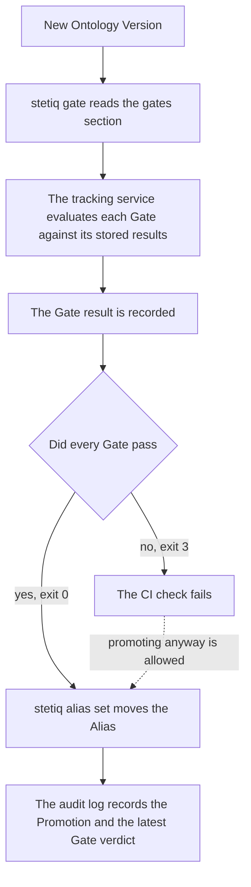

# stetiq.yaml

`stetiq.yaml` is the repo config: a YAML file you keep in your own repository, next to the code that builds your Knowledge Graph. It tells the CLI which Knowledge Graph the repository works on, how to start a Construction Run, when an Observation counts as Drift, and which Gates an Ontology Version must pass before you promote it.

The CLI reads `./stetiq.yaml` by default. Every command that reads it takes `--config PATH` to use another file.

```yaml
knowledge_graph: support

entry_point:
  command: python build_graph.py --ontology {ontology} --scope {graph_source}

drift:
  max_count_drop: 0.1

gates:
  - name: no-breaking-changes
    check: ontology_diff
    max_classification: deprecating
  - check: conformance
    min_score: 0.95
```

The file must be a YAML mapping. An empty file is an empty config. Each section is read only by the command that uses it, so a bad Gate in `gates:` doesn't stop `stetiq run`. Top-level keys stetiq doesn't know are ignored, so you can keep your own settings in the same file.

| Section | Read by | What it sets |
| --- | --- | --- |
| [`knowledge_graph`](#knowledge_graph) | `stetiq run`, `stetiq observe`, `stetiq gate` | The Knowledge Graph to use when the command doesn't name one. |
| [`entry_point`](#entry_point) | `stetiq run` | The Construction Entry Point: the command a Construction Run starts. |
| [`drift`](#drift) | `stetiq observe` | Thresholds for statistical Drift. |
| [`gates`](#gates) | `stetiq gate` | The Gates to evaluate for an Ontology Version or a Construction Run. |

## knowledge_graph

The name of a Knowledge Graph, as a string. `stetiq run`, `stetiq observe` and `stetiq gate` use it when you don't pass a Knowledge Graph on the command line. A name on the command line always wins.

```yaml
knowledge_graph: support
```

Without it, those commands need the name as their first argument, or they exit with an error.

## entry_point

The Construction Entry Point: the command `stetiq run` starts as a Construction Run. stetiq starts it, waits for it to exit, then observes the Graph Source. It never knows what the command does inside.

```yaml
entry_point:
  command: python build_graph.py --ontology {ontology} --scope {graph_source}
```

`command` is either a string or a list of arguments:

- **A string** is split into arguments the way a shell would split it, but no shell runs it. Pipes, `&&`, `$VARS` and globs are not interpreted. To use them, run a script.
- **A list** is used as-is, one item per argument. Use it when an argument contains spaces or quotes:

```yaml
entry_point:
  command:
    - python
    - build_graph.py
    - --ontology
    - "{ontology}"
    - --database
    - "{database}"
```

The command runs in the directory that holds the config file, and inherits your environment. stetiq replaces these placeholders inside each argument:

| Placeholder | Replaced with |
| --- | --- |
| `{ontology}` | The path to a temporary YAML file holding the Declared Ontology for this run. |
| `{graph_source}` | The bound Graph Source scope as JSON: `{"database": ..., "label": ..., "namespace": ...}`. |
| `{database}`, `{label}`, `{namespace}` | One part of that scope each, or an empty string when it isn't set. |
| `{knowledge_graph}` | The Knowledge Graph's name. |
| `{ontology_version}` | The number of the Ontology Version the run consumes. |
| `{run_id}` | The Construction Run's id. |

Connection details such as `STETIQ_GRAPH_SOURCE_URI` are never put into the command. Your command reads them from the environment itself.

`stetiq run` exits 1 if the config has no `entry_point.command`, or if `command` is empty or isn't a string or a list of strings. It also exits 1 whenever the run doesn't finish, for example because the command exited non-zero or strict Evolution Mode observed new Concepts.

## drift

Thresholds for statistical Drift, checked by `stetiq observe`. Each is a fraction of a type's count in the previous Observation: `0.1` is 10%.

```yaml
drift:
  max_count_drop: 0.1      # a node or relationship type losing more than 10% is Drift
  max_count_increase: 0.5  # a type growing by more than 50% is Drift
```

| Key | Drift when |
| --- | --- |
| `max_count_drop` | A node or relationship type's count falls by more than this fraction. |
| `max_count_increase` | A node or relationship type's count rises by more than this fraction. |

Both keys are optional, and each must be a non-negative number. A change exactly at the threshold isn't Drift. Without a `drift:` section, or without a key, that statistical check is off. Structural Drift (Concepts that are observed but not declared by the Contract Alias's Ontology Version, or declared but no longer observed) is always checked.

Any other key in `drift:` is an error. `stetiq observe` exits 3 on Drift and 1 on an error. If you run it without `--config` and there is no `./stetiq.yaml`, it uses an empty config. A `--config` file that doesn't exist is an error.

## gates

A Gate is a rule over Evaluator results, Conformance or the Ontology Diff that must hold for a CI check to pass. `gates:` is a list, one entry per Gate. Each entry has a `check`, which picks the kind of Gate, and that kind's settings.

```yaml
gates:
  - name: no-breaking-changes
    check: ontology_diff
    max_classification: deprecating
  - name: graph-conforms
    check: conformance
    min_score: 0.95
  - name: questions-answerable
    check: metric
    evaluator: structural_answerability
    metric: answerable_ratio
    min: 0.8
  - name: no-type-collapses
    check: count_drop
    max_drop: 0.2
```

`name` is optional and defaults to the `check`, so two Gates of the same kind need names. Names must be unique. Any key a Gate's kind doesn't list below is an error, which catches typos such as `min_scor`.

### ontology_diff

No change in the Ontology Diff from the Contract Alias's Ontology Version to the gated version may be more severe than `max_classification`.

| Key | Value |
| --- | --- |
| `max_classification` | Required. `additive`, `deprecating` or `breaking`, from least to most severe. |

With `max_classification: additive`, only additive changes pass. `breaking` lets every change through, which is useful to record the diff without failing on it. When it fails, its reasons list each change that is too severe.

```yaml
gates:
  - check: ontology_diff
    max_classification: additive
```

### conformance

The Conformance score of the Construction Run must be at least `min_score`.

| Key | Value |
| --- | --- |
| `min_score` | Required. A number from 0 to 1. |

When you gate an Ontology Version, the run is the latest one that produced it as a Candidate or consumed it. The Gate fails if no such run has Conformance. When it fails, its reasons list the mismatches.

```yaml
gates:
  - check: conformance
    min_score: 1.0
```

### metric

One metric of one Evaluator's latest result must lie within `min` and `max`.

| Key | Value |
| --- | --- |
| `evaluator` | Required. The Evaluator's name: a built-in one (below) or one of your custom Evaluators. |
| `metric` | Required. A metric that Evaluator reports. |
| `min` | Optional. The lowest value that passes. |
| `max` | Optional. The highest value that passes. |
| `parameters` | Optional. A mapping that picks one result when the Evaluator ran with several configurations. |

Give `min`, `max` or both, and `min` can't be greater than `max`. Both bounds are inclusive.

stetiq looks for the Evaluator's result on the gated Ontology Version first. If the version has none, it uses the run's result, which is how a Gate reaches run-level Evaluators such as `conformance` or `competency_question_execution`. The Gate fails if there is no result, if the Evaluator doesn't report that metric, or if it has several results with different parameters and `parameters` doesn't pick one.

```yaml
gates:
  - name: shallow-hierarchy
    check: metric
    evaluator: hierarchy
    metric: max_depth
    max: 4
  - name: no-orphans
    check: metric
    evaluator: orphan_concepts
    metric: orphan_concepts
    max: 0
  - name: questions-run
    check: metric
    evaluator: competency_question_execution
    metric: pass_ratio
    min: 1.0
```

`gold_alignment` runs once per gold reference you pass it, and each result records its reference in its parameters. Name the reference to gate on it:

```yaml
gates:
  - name: matches-gold
    check: metric
    evaluator: gold_alignment
    metric: recall
    min: 0.9
    parameters:
      reference_knowledge_graph: support-gold
      reference_version: 3
```

#### Evaluators and their metrics

These Evaluator names are built in. stetiq computes their results itself, and a custom Evaluator can't use them. Every Ontology Version gets the version-level ones when it's registered or re-evaluated, and every Construction Run with an Observation gets the run-level ones.

| Evaluator | Runs on | Metrics |
| --- | --- | --- |
| `hierarchy` | Ontology Version | `max_depth`, `max_breadth`, `root_node_types`, `max_children` |
| `isolated_node_types` | Ontology Version | `isolated_node_types`, `isolated_node_type_ratio` |
| `orphan_concepts` | Ontology Version | `orphan_concepts`, `orphan_node_types`, `orphan_relationship_types`, `orphan_concept_ratio` |
| `redundancy` | Ontology Version | `redundant_patterns`, `redundant_properties`, `duplicate_structure_concepts` |
| `constraint_consistency` | Ontology Version | `inconsistencies`, `inherited_duplicate_constraints`, `unique_optional_properties`, `constraints_on_deprecated`, `deprecated_replacements` |
| `structural_answerability` | Ontology Version, when the Knowledge Graph has a Use Case | `questions`, `answerable_questions`, `unanswerable_questions`, `unmapped_questions`, `answerable_ratio` |
| `conformance` | Construction Run | `score`, `mismatches` |
| `observed_schema` | Construction Run | `node_types`, `relationship_types`, `patterns`, `nodes`, `relationships`, `properties`, `mean_fill_rate` |
| `competency_question_execution` | Construction Run, recorded by the SDK | `questions`, `passed_questions`, `failed_questions`, `skipped_questions`, `pass_ratio` |

`gold_alignment` ships with stetiq too, but you run it yourself with a reference of your choice. It reports `precision`, `recall`, `matched_concepts`, `unmatched_evaluated_concepts` and `unmatched_reference_concepts`. A custom Evaluator reports whatever metrics it returns.

### count_drop

No node or relationship type's count in the Observed Schema may fall by more than `max_drop` from the Observation before it.

| Key | Value |
| --- | --- |
| `max_drop` | Required. A fraction from 0 to 1: `0.2` is 20%. |

A type that disappears dropped 100%, and new types are ignored. The Gate passes if there is no earlier Observation to compare with, and fails if the subject has no Observation at all.

```yaml
gates:
  - check: count_drop
    max_drop: 0.25
```

### How Gates are evaluated

`stetiq gate` reads the `gates:` section and asks the tracking service to evaluate them, for the latest Ontology Version by default, for `--version N`, or for a Construction Run with `--run ID`. A run stands for its Candidate if it produced one, else for the version it consumed.

```bash
stetiq gate support --version 7
```

```text
PASS  no-breaking-changes
FAIL  graph-conforms
      - Conformance 0.9123 < 0.95
      - undeclared node_type Refund
1 of 2 Gates failed for support Ontology Version 7
```

The tracking service evaluates each Gate against the results it has stored itself, so a Gate result can't be forged by the client. It records the result together with the Gate definitions it used. `stetiq gate-results support` lists every recorded result.

The exit code is meant for CI: **0** when every Gate passed, **3** when a Gate failed, and **1** on an error, such as a missing config file, a bad Gate, a `gates:` section with no Gates, or an unknown Knowledge Graph or version.

A Promotion is never blocked by Gates. You promote by moving an Alias, and the audit log records whether the version's latest Gate result passed. The usual flow is to gate in CI and promote only on success:



```bash
stetiq gate support --version 7 && stetiq alias set support production 7
stetiq alias log support
```

The `GATE` column of `stetiq alias log` shows `passed`, `failed`, or `-` for a version that was never gated.
