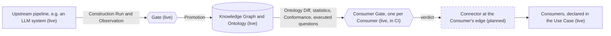

# Vision: stetiq between the upstream pipeline and its Consumers

stetiq keeps a Knowledge Graph's Ontology as a versioned contract with two sides: the upstream pipeline that builds to an **Ontology Version**, and the **Consumers** that declare in the **Use Case** what they depend on ([ADR 0010](adr/0010-the-ontology-is-a-versioned-contract-between-the-pipeline-and-its-consumers.md)). The pipeline's side is built: Gates, Conformance and Promotion. On the Consumers' side, Consumers and Tasks, Consumer impact and the Consumer Gate in CI are built. This page describes the rest of the Consumers' side. It says what the MVP builds, what it only shows as "Planned", and what a later team would build. Words in **bold** are defined in [GLOSSARY.md](../GLOSSARY.md).

Nothing on this page beyond the "MVP builds" list is implemented. The integration contract for Consumers is written up separately in [the Consumer Connector spec](specs/consumer-connector.md); of it, only the Consumer Gate verdict is implemented.

## The two-gate pipeline

A Knowledge Graph sits between two kinds of check. A **Gate** guards the input side: is what the upstream pipeline produced good enough? A **Consumer Gate** guards the output side, one per **Consumer**: is what the Knowledge Graph now offers fit for that Consumer's **Tasks**?

Each box says whether it is live or planned, and planned boxes are drawn dashed.

- **Upstream pipeline.** The user's own extraction workflow, often an LLM system that reads documents and writes the graph. stetiq records each execution as a **Construction Run** and never knows what happens inside it.
- **Gate** (live). Rules in the user's repository, over Evaluator results, **Conformance** and the **Ontology Diff**, that a CI check enforces with `stetiq gate`. Its results go back to the upstream pipeline, so the people who own extraction see what to fix.
- **Knowledge Graph and Ontology.** The registry of **Ontology Versions** and **Aliases**. A **Promotion** moves the **Contract Alias** to a new version.
- **Consumer Gate** (live, in CI). For one Consumer, rules over what a new Ontology Version or Construction Run offers that Consumer compared with the version it takes now, declared on the Consumer in the Use Case. The upstream pipeline's CI checks them with `stetiq consumer gate`, beside `stetiq gate`.
- **Consumers** (live as declarations). Anyone or anything that uses the Knowledge Graph downstream, declared in the **Use Case** with the Tasks they perform and the **Competency Questions** those Tasks need answered.

## Consumer Gate

A Consumer Gate is a rule, for one Consumer, judged against the Ontology Version that Consumer takes now, that must hold for it to take a new one. Unlike a Gate, which judges absolute health, it judges what that Consumer would lose: **Consumer Drift**. It judges only four inputs:

- **Observed Schema** statistics: counts per Class and Relation, cardinalities, Attribute fill rates.
- **Conformance** of the Graph Source to its Declared Ontology.
- the **Ontology Diff** between the version the Consumer uses now and the version on offer, with each change classed cosmetic, additive, deprecating or breaking.
- executed Competency Question results: whether the questions the Consumer's Tasks need actually returned what they should when run against the Graph Source.

It never looks at instance data ([ADR 0001](adr/0001-ontology-not-instance-data.md)). Executed Competency Questions run in the user's own process, as they do today: their rows are judged and then dropped, and only the result reaches stetiq.

Examples of Consumer Gates a Consumer might want:

- "No breaking change touches a Concept my Tasks need."
- "Every Competency Question my triage Task needs passed on the latest Construction Run."
- "The WorkOrder Class still has at least 1,000 instances, and its status Attribute is filled at least 95% of the time."

Consumer Gates are declared on each Consumer in the Use Case, so the Consumer's team owns them, and the server evaluates them against the latest finished Construction Run on the Contract Alias's version ([ADR 0008](adr/0008-consumer-gates-are-declared-in-the-use-case.md)). The kind built today, `row_count_drop`, fails when a Competency Question of one Task returns more than a set share fewer rows than on that baseline, or when it cannot be compared. A verdict names the symptom (the Consumer, Task, Competency Question and row change), never a guessed cause.

stetiq **evaluates** a Consumer Gate; it is **enforced** wherever its verdict is checked ([ADR 0005](adr/0005-core-computes-over-artifacts-connectors-and-monitoring-live-at-the-edge.md)). Today that is the upstream pipeline's CI: `stetiq consumer gate` beside `stetiq gate`, so a pull request shows "Gate ✅ / Consumer Gate ❌" when a change is better by every evaluation but would break a Consumer. Later it will also be the Consumer's **Connector**: before its deployment takes Ontology Version 6, it asks stetiq "is version 6 safe for me?", and fails its own deployment if the answer is no. The core computes the verdict over artifacts it already holds and never reaches into the Consumer's systems.

This mirrors how a Gate works. A Gate does not block a Promotion, the CI check that runs it does. A Consumer Gate does not block a Consumer, the CI check or the Connector does.

Evaluating Consumer Gates on each scheduled Observation, so that monitoring catches Consumer Drift between pipeline changes, is planned.

## Connector

A Connector is what sits at a Consumer's edge and links it to stetiq. It does two things:

1. **It tells the Consumer about Ontology changes that affect its Tasks.** When a Promotion moves the Contract Alias, or a new Candidate carries breaking or deprecating changes, stetiq works out which Consumers, Tasks and Competency Questions the change reaches (Consumer impact, see below) and the Connector delivers that to the Consumer's team: a message, an issue, a failing check.
2. **It enforces the Consumer's Consumer Gate.** It asks stetiq for a verdict on an Ontology Version and acts on it in the Consumer's own deployment.

Like Graph Source adapters, a Connector runs outside the core: in the Consumer's CI, in a small service the Consumer runs, or as a webhook receiver. The core only emits events and answers verdict requests over artifacts it holds. This follows from ADR 0005, so it needs no new ADR. A server-side connector API that opened connections into Consumers' systems would reverse that decision.

The events, payload, delivery options and verdict request are specified in [the Consumer Connector spec](specs/consumer-connector.md).

### Example Connectors

The web UI's Connector picker (**Connect** on each Consumer tile) shows these example tools, grouped by what a Connector does. None is built, and each would run at the Consumer's edge.

- **Enforce in CI**
  - **GitHub Actions**: a check in the Consumer's repository that asks for a Consumer Gate verdict and fails the pull request that bumps the Consumer's Ontology Version when its Consumer Gate fails.
  - **GitLab CI**: the same check as a job in the Consumer's GitLab pipeline, failing the merge request.
- **Get notified**
  - **Webhook**: a receiver at a URL the Consumer's team registers, which gets a signed event when an Ontology change affects the Consumer's Tasks.
  - **Slack**: tells the Consumer's team in its channel when an Ontology change affects its Tasks.
  - **GitHub Issues**: opens an issue in the Consumer's repository when an Ontology change affects its Tasks.
- **In the Consumer's code**
  - **LangChain** and **LlamaIndex**: a guard in the Consumer's code that asks for a Consumer Gate verdict before an agent uses a new Ontology Version, and keeps it on the version it takes if the verdict fails.

## Consumer impact, and Gates over it

Consumer impact answers "which Consumers does this Ontology change hit?". It follows each change in an Ontology Diff through Concept → Competency Question → Task → Consumer. A breaking change makes a Task *affected*. A deprecating change makes it *will be affected*. A Competency Question that only the question mapper could map onto the Ontology gets impact *unknown*, and is never reported as unaffected.

The MVP builds Consumer impact itself. A Gate over it is planned: a Gate in the user's `stetiq.yaml` such as "fail if a breaking change affects any Consumer", or "fail if the Consumer `maintenance-planner` is affected". It would let the upstream side see, in its own CI, the damage a Candidate would do downstream, before any Consumer has to ask.

## Pending Migration and Adoption

Two parts of Drift handling are planned, and the web UI shows them where Drift is shown:

- **Pending Migration.** After a Promotion, the Graph Source takes time to catch up with the new Contract Alias version. Drift that the Ontology Diff, from the last version the Graph Source was observed to conform to up to the current one, explains will be shown as a Pending Migration, raising no alert until a grace period ends.
- **Adoption.** When an Observation finds Concepts the Contract Alias's version does not declare, or no longer finds Concepts it does, the user will select which to take into a new Candidate: selected undeclared Concepts are added, selected vanished ones deprecated, never removed.

## AI and MCP authoring

Two kinds of agent work around a Knowledge Graph: the coding agents that build the upstream pipeline and so define the Ontology, and the agents inside each Consumer.

**Built: a read-only MCP server for the Ontology's definer.** [`stetiq mcp`](guide/08-agents-and-mcp.md) gives a coding agent (Claude Code, Cursor) improving the upstream pipeline a read-only view of how the pipeline's output was judged: the **Run Context**, the Knowledge Graphs, Ontology Diffs and Consumer impact. Its instructions state the loop's rules: extend the Ontology only where a Competency Question needs it, read a Consumer Gate verdict as a symptom rather than a cause, and leave acceptance to a person reviewing the pull request, where `stetiq gate` and `stetiq consumer gate` judge it. It runs over stdio at the edge, with the CLI's tracking URI and API Token; a hosted MCP endpoint waits for a hosted instance.

**Planned: drafting and proposing.** Writing a good Use Case is slow: naming the Consumers, splitting their work into Tasks, and phrasing the Competency Questions each Task needs. AI can draft much of it, and agents can propose changes. All of this stays planned:

- **Agents propose Consumers, Tasks and Competency Questions.** From the Ontology, the Use Case so far and whatever the team gives it (a product spec, a dashboard's queries, an agent's tool list), an agent drafts new Consumers, Tasks and Competency Questions, and maps each question onto the Ontology's Concepts.
- **Proposal tools over MCP.** `stetiq mcp` would gain tools that propose a change to the Use Case (a new Task or Competency Question) instead of only reading.
- **A Consumer-side MCP schema server**, a Connector at the Consumer's edge: an agent working in a Consumer's repository could read the Use Case, see which of its Tasks are ready on the latest Ontology Version, and propose a new Task or Competency Question for the Consumer it serves.

AI only ever **proposes**. A person accepts what becomes a new **Use Case Version**, as with **Adoption**, where the user selects which observed Concepts go into a Candidate. Nothing an agent drafts changes a Use Case until someone accepts it, and the accepted Use Case Version records who did.

The seed exists today: the LLM question mapper (`stetiq server --question-mapper anthropic`, or `$STETIQ_QUESTION_MAPPER`). It maps a Competency Question that has no query onto the Concepts and paths of an Ontology, and structural answerability then judges those Concepts against the Ontology Version like any other mapping. If the mapper fails, the question counts as unmapped, so versioning is never blocked. Drafting Tasks and questions extends the same idea from mapping a question to proposing one.

## What the MVP builds, and what it only shows

The MVP **builds**:

- **Consumers and Tasks** in the Use Case: who uses the Knowledge Graph, the Tasks they perform, and the Competency Questions each Task needs, versioned with the Use Case and editable in the web UI.
- **Consumer impact** of an Ontology Diff, in the SDK, the CLI, the Ontology Diff view and the Promotion confirmation.
- **Task readiness**: how many of a Task's Competency Questions the Ontology Version being viewed can answer, and which questions serve no Task.
- **A read-only MCP server for coding agents** (`stetiq mcp`), serving the Run Context, Ontology Diffs and Consumer impact to the agents that improve the upstream pipeline, with the loop's rules as its instructions.
- **The Consumer Gate, checked in CI on a Candidate**: Consumer Gates declared on each Consumer in the Use Case (`row_count_drop`), evaluated and recorded by the server against the Contract Alias baseline, run by `stetiq consumer gate` in the upstream pipeline's CI, and shown on each Consumer tile with its latest verdict (in full in the Consumer's sheet) and in the pipeline strip on the Knowledge Graph overview.

The MVP **shows, as "Planned"** (placeholders in the web UI that link to this page, or notes in the guide):

- evaluating Consumer Gates on each scheduled Observation (monitoring), beside the Consumer Gate in each Consumer's sheet;
- the Connector, as **Connect** on each Consumer tile, which opens a picker of the [example Connectors](#example-connectors), each disabled;
- Pending Migration and Adoption, where an Observation's Drift is shown;
- a Gate over Consumer impact, on the Gates view;
- drafting Tasks and Competency Questions with AI, on the Use Case page;
- a hosted stetiq instance, installing from PyPI, and a quickstart for bringing your own pipeline, in the guide's Getting started.

Everything else on this page, the Connector and its events, the other Consumer Gate kinds, Gates over Consumer impact, MCP proposal tools and the Consumer-side MCP schema server, is left for a later team.
