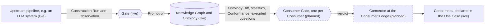

# Vision: stetiq between the upstream pipeline and its Consumers

stetiq is the evaluation point in upstream pipeline → stetiq → Knowledge Graph → Consumers. Today it judges the input side well: what the upstream pipeline produced, and whether its Ontology Versions are fit to promote. This page describes where stetiq goes next on the output side, towards the Consumers. It says what the MVP builds, what it only shows as "Planned", and what a later team would build. Words in **bold** are defined in [GLOSSARY.md](../GLOSSARY.md).

Nothing on this page beyond the "MVP builds" list is implemented. The integration contract for Consumers is written up separately in [the Consumer Connector spec](specs/consumer-connector.md), which is not implemented either.

## The two-gate pipeline

A Knowledge Graph sits between two kinds of check. A **Gate** guards the input side: is what the upstream pipeline produced good enough? A **Consumer Gate** guards the output side, one per **Consumer**: is what the Knowledge Graph now offers fit for that Consumer's **Tasks**?

Each box says whether it is live or planned, and planned boxes are drawn dashed.

- **Upstream pipeline.** The user's own extraction workflow, often an LLM system that reads documents and writes the graph. stetiq records each execution as a **Construction Run** and never knows what happens inside it.
- **Gate** (live). Rules in the user's repository, over Evaluator results, **Conformance** and the **Ontology Diff**, that a CI check enforces with `stetiq gate`. Its results go back to the upstream pipeline, so the people who own extraction see what to fix.
- **Knowledge Graph and Ontology.** The registry of **Ontology Versions** and **Aliases**. A **Promotion** moves the **Contract Alias** to a new version.
- **Consumer Gate** (planned). For one Consumer, rules over what the new Ontology Version offers that Consumer.
- **Consumers** (live as declarations). Anyone or anything that uses the Knowledge Graph downstream, declared in the **Use Case** with the Tasks they perform and the **Competency Questions** those Tasks need answered.

## Consumer Gate

A Consumer Gate is a rule, for one Consumer, that must hold for that Consumer to take an Ontology Version. It judges only four inputs:

- **Observed Schema** statistics: counts per Class and Relation, cardinalities, Attribute fill rates.
- **Conformance** of the Graph Source to its Declared Ontology.
- the **Ontology Diff** between the version the Consumer uses now and the version on offer, with each change classed cosmetic, additive, deprecating or breaking.
- executed Competency Question results: whether the questions the Consumer's Tasks need actually returned what they should when run against the Graph Source.

It never looks at instance data ([ADR 0001](adr/0001-ontology-not-instance-data.md)). Executed Competency Questions run in the user's own process, as they do today: their rows are judged and then dropped, and only the result reaches stetiq.

Examples of Consumer Gates a Consumer might want:

- "No breaking change touches a Concept my Tasks need."
- "Every Competency Question my triage Task needs passed on the latest Construction Run."
- "The WorkOrder Class still has at least 1,000 instances, and its status Attribute is filled at least 95% of the time."

stetiq **evaluates** a Consumer Gate; the Consumer's **Connector** **enforces** it, at the edge ([ADR 0005](adr/0005-core-computes-over-artifacts-connectors-and-monitoring-live-at-the-edge.md)). The core computes the verdict over artifacts it already holds. It never reaches into the Consumer's systems, and nothing in stetiq stops a Consumer from taking a version. The Consumer asks instead: before its deployment takes Ontology Version 6, its Connector asks stetiq "is version 6 safe for me?", and fails its own deployment if the answer is no.

This mirrors how a Gate works today. A Gate does not block a Promotion, the CI check that runs it does. A Consumer Gate does not block a Consumer, the Connector does.

## Connector

A Connector is what sits at a Consumer's edge and links it to stetiq. It does two things:

1. **It tells the Consumer about Ontology changes that affect its Tasks.** When a Promotion moves the Contract Alias, or a new Candidate carries breaking or deprecating changes, stetiq works out which Consumers, Tasks and Competency Questions the change reaches (Consumer impact, see below) and the Connector delivers that to the Consumer's team: a message, an issue, a failing check.
2. **It enforces the Consumer's Consumer Gate.** It asks stetiq for a verdict on an Ontology Version and acts on it in the Consumer's own deployment.

Like Graph Source adapters, a Connector runs outside the core: in the Consumer's CI, in a small service the Consumer runs, or as a webhook receiver. The core only emits events and answers verdict requests over artifacts it holds. This follows from ADR 0005, so it needs no new ADR. A server-side connector API that opened connections into Consumers' systems would reverse that decision.

The events, payload, delivery options and verdict request are specified in [the Consumer Connector spec](specs/consumer-connector.md).

## Consumer impact, and Gates over it

Consumer impact answers "which Consumers does this Ontology change hit?". It follows each change in an Ontology Diff through Concept → Competency Question → Task → Consumer. A breaking change makes a Task *affected*. A deprecating change makes it *will be affected*. A Competency Question that only the question mapper could map onto the Ontology gets impact *unknown*, and is never reported as unaffected.

The MVP builds Consumer impact itself. A Gate over it is planned: a Gate in the user's `stetiq.yaml` such as "fail if a breaking change affects any Consumer", or "fail if the Consumer `maintenance-planner` is affected". It would let the upstream side see, in its own CI, the damage a Candidate would do downstream, before any Consumer has to ask.

## AI and MCP authoring

Writing a good Use Case is slow: naming the Consumers, splitting their work into Tasks, and phrasing the Competency Questions each Task needs. AI can draft much of it. The plan has two parts:

- **Agents propose Consumers, Tasks and Competency Questions.** From the Ontology, the Use Case so far and whatever the team gives it (a product spec, a dashboard's queries, an agent's tool list), an agent drafts new Consumers, Tasks and Competency Questions, and maps each question onto the Ontology's Concepts.
- **An MCP server lets agents read and edit a Use Case.** An agent working in a Consumer's repository could read the Use Case, see which of its Tasks are ready on the latest Ontology Version, and propose a new Task or Competency Question for the Consumer it serves.

AI only ever **proposes**. A person accepts what becomes a new **Use Case Version**, as with **Adoption**, where the user selects which observed Concepts go into a Candidate. Nothing an agent drafts changes a Use Case until someone accepts it, and the accepted Use Case Version records who did.

The seed exists today: the LLM question mapper (`stetiq server --question-mapper anthropic`, or `$STETIQ_QUESTION_MAPPER`). It maps a Competency Question that has no query onto the Concepts and paths of an Ontology, and structural answerability then judges those Concepts against the Ontology Version like any other mapping. If the mapper fails, the question counts as unmapped, so versioning is never blocked. Drafting Tasks and questions extends the same idea from mapping a question to proposing one.

## What the MVP builds, and what it only shows

The MVP **builds**:

- **Consumers and Tasks** in the Use Case: who uses the Knowledge Graph, the Tasks they perform, and the Competency Questions each Task needs, versioned with the Use Case and editable in the web UI.
- **Consumer impact** of an Ontology Diff, in the SDK, the CLI, the Ontology Diff view and the Promotion confirmation.
- **Task readiness**: how many of a Task's Competency Questions the Ontology Version being viewed can answer, and which questions serve no Task.

The MVP **shows, as "Planned" placeholders** that link to this page:

- the Consumer Gate, in a pipeline strip on the Knowledge Graph overview (upstream pipeline → Gate → Knowledge Graph → Consumer Gate → Consumers);
- the Connector and Consumer Gate on each Consumer card ("Connector: not connected", "Consumer Gate: none");
- a Gate over Consumer impact, on the Gates view;
- drafting Tasks and Competency Questions with AI, on the Use Case page.

Everything else on this page, the Connector, the Consumer Gate verdict, Gates over Consumer impact and the MCP server, is left for a later team.
